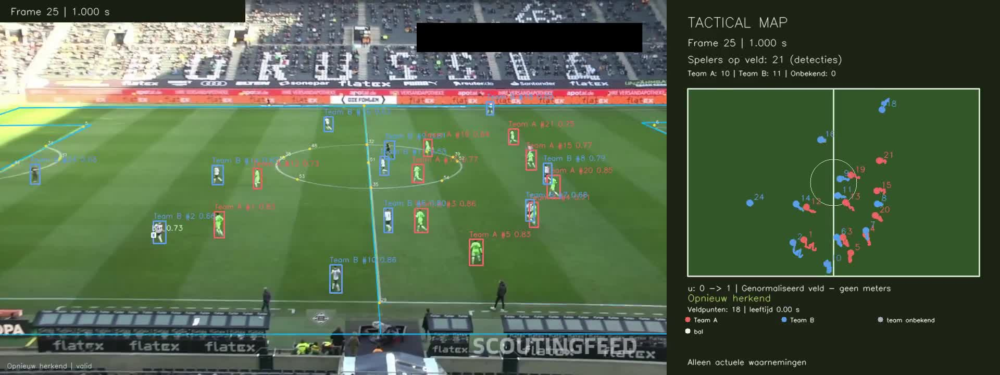
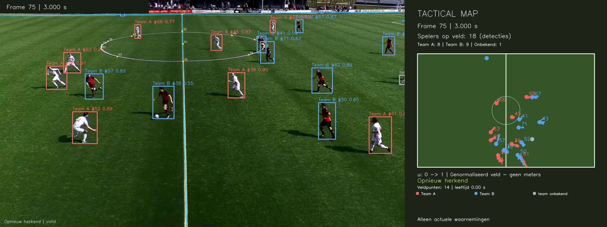
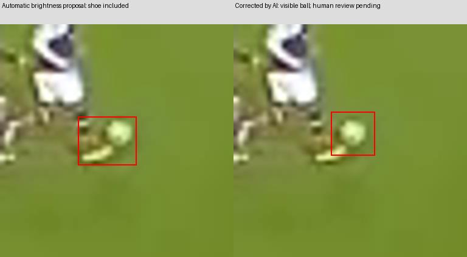
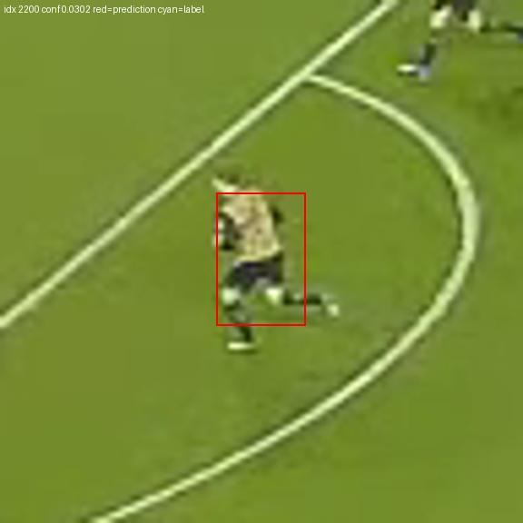

# Sports Vision & Tactical Mapping

**Projectrapport, versie 5 - 15 november 2026**

**Team:** Messi10 — Andrew, Milan Wouters, Raoul en Jorre

**Bronversie:** GitHub main `524d081a445dd57762e14eeb1e7142bbb9a3ba53`

**Bijdragen:** Milans videokeuze en ondersteund labelwerk; Andrews vierklassenmodel; Jorres integratie en inzending; Raouls oriëntatie en vergelijking van opties. AI-gebruik van alle vier teamleden is beschreven.

**Status:** documentatie bijgewerkt; open opleverpunten staan afzonderlijk vermeld.

## 1. Samenvatting

Sports Vision analyseert voetbalvideo met objectdetectie, perspectieftransformatie, tijdelijke speler-ID's en een gesynchroniseerde tactical map. Het project combineert bestaande en gefinetunede modellen met een lokale Streamlit-interface. De belangrijkste afwegingen gaan over kleine objecten, onderscheid tussen personenrollen, betrouwbare veldgeometrie en het verschil tussen een echte waarneming en een voorspelde positie.

Dit rapport verwerkt de bijdragen uit GitHub main en Jorres uploadbranch `8e29c3ff`. De uploadmap bevat de definitieve documenten, zijn twaalf-slidepresentatie als basis, uitvoer- en trainingscode en een werkelijk berekende demonstratie. Andrews `docs/VierKlassenModel.md` beschrijft zijn oorspronkelijke bal-/scheidsrechterprototype en zijn AI-gebruik. Zijn trainingsnotebook start van YOLOv8x en traint een model met vier klassen. De gezamenlijke broadcastpipeline gebruikt daarvan uitsluitend de baluitvoer; het bestaande YOLO11s-spelermodel blijft een afzonderlijke detector. Andrews eigen bewegingsvoorspelling is niet stilzwijgend gelijkgesteld aan de ByteTrack-route van de gezamenlijke app. [B24, B25, B28]

Jorre heeft de toepassing en controles afgerond en de menselijke review van de 80-beeldenselectie geregistreerd op 14 november. Volgens de expliciete teambevestiging zijn alle huidige labels goedgekeurd en vielen twijfelgevallen buiten deze selectie. De labels en de 48/32-split zijn niet aangepast. De oorspronkelijke AI/provider-herkomst blijft behouden. Dit actualiseert de eerdere documentatie waarin de review nog open stond. [B29, B30]

De ontwikkelmetingen ondersteunen concrete verbeteringen, maar geen algemene nauwkeurigheidsgarantie. Historische bal v3 verbetert de tegelroute tegenover v2, terwijl diezelfde v3 zonder tegels minder goed scoort. De opgehaalde YOLO26-handleiding behoudt het bestaande YOLO11s-model. Menselijke labelreview is geregistreerd en de koppeling van de 80 beelden aan de grotere historische baltraining is nu aangetoond. Een heldere vaste-camera-MVP-demonstratie en de individuele verdediging blijven aandachtspunten.

## 2. Opdracht en afbakening

De opdracht vraagt een MP4-fragment om te zetten naar een gesynchroniseerde 2D tactical map. Voetbal is toegelaten. Voor het MVP geldt één statische broadcast- of tactische camerahoek, zonder snelle cuts of extreme camerabeweging. De kern bestaat uit een bestaande detector, een gerichte set van 40-80 moeilijke beelden, ondersteunde annotatie, fine-tuning, beide mAP-maten, foutanalyse, minstens vier bekende veldpunten, een homography en een lokale interface. [B01]

De beoordelingsgewichten zijn 25% data en annotatie, 35% modellering en fine-tuning, 20% foutanalyse, 10% pipeline/homography en 10% proces/GenAI-eigenaarschap. Daarom beschrijft dit rapport de gevolgde keuzes en tegenresultaten, niet uitsluitend de interface. Tracking, automatische keypoints en teamanalyse zijn uitbreidingen boven op een degelijk MVP. De opdracht noemt geen verplichte YOLO-versie, minimum-mAP of minimum-FPS. Een aparte onafhankelijke eindtest is niet als afzonderlijk indieningsbestand voorgeschreven, maar blijft nodig voor sterke claims over ongeziene wedstrijden.

Het indieningsbericht vraagt één ZIP per team met PDF-rapport, trainingsnotebook of vergelijkbare Python-code, uitvoercode en presentatie. De GitHub-map `Documentatie` bevat de compacte, leesbare documenten en hun bewerkbare bronnen. De definitieve inzending wordt samengebracht in `Upload_CV_Challenge_2026_11_14`, met een nieuwe ZIP van precies die map. Het rapport en de presentatie in die map zijn identiek aan de actuele bestanden onder Documentatie. Oude ZIP-bestanden blijven historische versies.

### 2.1 Welke codeversie wordt beschreven?

Voor het uploadpakket gebruiken we Jorres branch `8e29c3ff`, met hoofdbron `524d081a`, draagbare uploadstarters, trainingsdata, gewichten en demonstratie. `03_Code/START_HIER.md` beschrijft deze route. De inhoudelijke documentatie is op 15 november aangevuld, inclusief controleerbare v2-baltrainingsbijlagen uit de oorspronkelijke projectbestanden; dit is geen nieuwe modeltraining. De uitvoercode is niet stilzwijgend vervangen door andere lokale appaanpassingen. [B31]

De gezamenlijke functies worden beschreven voor de opgehaalde hoofdbron op `524d081a`. De GitHub-map `final` is een afzonderlijk eindpakket met de eenvoudige schoolroute als standaardstart volgens haar meegecommitte README. De hoofdbron biedt de gezamenlijke automatische route. Lokale, niet-gepubliceerde uitbreidingen worden niet als al gedeelde GitHub-functionaliteit voorgesteld. [B02, B27]

Dit onderscheid is belangrijk: een lokaal behouden uitgebreidere final-kopie heeft andere starters en meer bestanden dan het getrackte GitHub-eindpakket. Het nieuwe openbare verslag gebruikt daarom het bronversie-overzicht en schrijft historische metingen aan hun oorspronkelijke profiel toe. Het controleverslag van 14 november meldt 360 gecontroleerde bestanden voor het getrackte eindpakket. Een groter lokaal bestandsaantal bewijst geen nieuwere gedeelde release. [B29]

## 3. Gegevenspad en geïntegreerde oplossing

De interface verzamelt de video en instellingen. `video.py` leest afmetingen, bronframes en tijdstippen. `detection.py` laadt de gekozen gewichten en zet boxen en klassen om naar gedeelde records in bronbeeldcoördinaten. Aanvullende rol- en shirtmodellen helpen bij personenrollen en teams. Veldgeometrie komt uit aangeklikte puntparen of de automatische veldruntime. De pipeline koppelt detecties aan het juiste tijdstip en laat de renderer video en minimap tekenen. [B08]

Voor een geschikte spelerbox gebruikt de projectie het midden onderaan als benadering van het grondcontact. Tracking voegt tijdelijke ID's toe; teamlogica doet een voorstel voor A, B of onbekend. Een gedeeld framerecord bewaart de relatie tussen bronframe, box, model, tijdstip, identiteit en veldstatus. Daardoor kunnen opgeslagen analyses en framecontrole dezelfde informatie teruglezen zonder opnieuw te detecteren.

### 3.1 Actueel broadcastprofiel

| Onderdeel | Rol en invoerinstelling |
|---|---|
| Spelers | `broadcast-pitch-players-v7`, YOLO11s, invoer 1920, confidence 0,10 |
| Persoonsvoorstellen | COCO-person-detector, invoer 1920, confidence 0,10 |
| Andrew-bal | Vierklassencheckpoint beperkt tot bronklasse 0, invoer 1280, confidence 0,03, NMS-IoU 0,50 |
| Rollen en teams | Afzonderlijke rolclassifier, shirtkenmerken en context; onbekende uitkomst blijft mogelijk |
| Veld | Afzonderlijke PnLCalib-punten-/lijnruntime en geometriecontrole |
| Tracking | Gedeelde ByteTrack-route met camerabewegingscontrole waar ingeschakeld |

Het afzonderlijke Andrew-profiel kan ook zijn vier klassen gebruiken: ball, goalkeeper, player en referee. Een keeper wordt daarbij als speler verwerkt met een apart keeperkenmerk. Het broadcastprofiel houdt Andrews rol beperkt tot de bal; zijn spelers en scheidsrechters vervangen daar niet automatisch de bestaande detectors. De gewichtshash is `78a847ecd67f78566e666a54aabca6141e7e63495fb76783e17b3a859d90fee9`. [B24, B25]

### 3.2 Spelersweergave en tracking

De spelersschuif begint op 0,25 en loopt van 0,10 tot 0,95. Een bewuste aanpassing maakt het weergavebeleid strikt voor boxen, minimap, actuele trajectpunten, telling en teams, ook bij bestaande ID's. Lage-confidence-detecties blijven intern beschikbaar voor tracking. De herstelknop herstelt zowel 0,25 als het oorspronkelijke beleid voor actuele gevolgde spelers. Aanpassen start geen zware heranalyse: de gebruiker kiest daarna Verwerken. Het effectieve `player_policy` hoort bij runmanifest en cache. Andrews balinstellingen en de interne trackingdrempels worden niet overschreven. [B23]

Een tijdelijk ID is geen naam, rugnummer of garantie op een blijvende identiteit. Occlusie, overlap en camerawissels kunnen nieuwe ID's veroorzaken. Een beeld-ID kan bij ontbrekend veld blijven bestaan, terwijl veldtrajecten en afstandsintervallen moeten worden onderbroken.

## 4. Data, annotatie en geregistreerde teamreview

De gerichte datakloof is de kleine, snel bewegende voetbal. Verkleining, blur, gedeeltelijke bedekking en gelijkenis met schoenen of kleding maken de taak moeilijk. Een bal van enkele bronpixels kan in de modelinvoer nog kleiner worden. De balexperimenten onderzoeken daarom resolutie, native uitsneden en tegelinferentie.

De definitieve reviewselectie staat onder `final/datasets/school-ball80-review-v1`: 80 beelden met labels, verdeeld in 48 train en 32 validatie. Wedstrijdgroepen zijn gescheiden. Op 14 november is geregistreerd dat het projectteam alle huidige 80 labels gecontroleerd en goedgekeurd heeft. Twijfelgevallen vielen buiten de behouden selectie. Er zijn bij die registratie geen boxen, beelden of splits gewijzigd. [B13, B30]

De oorspronkelijke annotator blijft Codex (AI), met providerlabels als voorstellen. De menselijke review volgt uit de expliciete gebruikersbevestiging die Jorre heeft vastgelegd. Namen van afzonderlijke reviewers en de oorspronkelijke uitvoeringsdatum zijn niet opgegeven. De registratietijd is dus geen gereconstrueerd tijdstip van de menselijke bespreking. De verklaring geldt uitsluitend voor deze 80 beelden en niet automatisch voor andere datasets. [B30]

### 4.1 Labelregels en omgaan met meningsverschillen

De klasse is ball. Ook een zichtbare reservebal valt daaronder; detectie bepaalt niet automatisch welke bal in het spel is. Gebruik een strakke box rond de zichtbare bal en beoordeel zowel het volledige beeld als een vergroting. Schoenen, shirts en veldlijnen zijn geen bal. Bij blur of gedeeltelijke occlusie moet de regel consistent blijven; voor een volledig onzichtbare of niet lokaliseerbare bal wordt geen positie verzonnen.

Twijfel maakt een beeld niet automatisch negatief. Een leeg label kan alleen als negatief gelden na controle dat er werkelijk geen doelobject zichtbaar is. Volgens de teamverklaring zijn twijfelgevallen uitgesloten en zijn de overige labels gezamenlijk vastgesteld. Er zijn geen aantallen meningsverschillen, specifieke voor/na-correcties of individuele stemmen achteraf verzonnen. De geaccepteerde bestanden zijn gelijk aan de oorspronkelijk geleverde labels. [B30]

### 4.2 De datasets blijven onderscheiden

De 80 reviewbeelden zijn niet hetzelfde als de dataset achter de historische v2/v3-balmetingen. Die rondes gebruiken 282 crops uit 132 bronbeelden: 197 trainingscrops, waaronder 175 positief en 22 gecontroleerd negatief, en 85 validatiecrops, waaronder 73 positief en twaalf negatief. Alle crops van één bronbeeld behouden dezelfde split. De volledige-beeldenevaluatie gebruikt 73 validatiebeelden uit drie wedstrijden. [B10]

Andrews vierklassenbijdrage heeft volgens de herkomstregistratie 612 trainingsbeelden, 38 validatiebeelden en dertien apart gehouden testbeelden. Bronframefamilies zijn gescheiden; volledige wedstrijdscheiding en onafhankelijke nauwkeurigheid zijn niet bevestigd. Andrew noemt de publieke `football-players-detection-1`-verzameling bij DFL-Bundesliga-Data-Shootout-Analysis als bron. Dat is zijn bronvermelding, geen nieuwe licentie- of datakwaliteitsaudit door dit rapport. [B25, B28]

De bestaande multisource-spelerdata en de trainingscatalogus zijn aanvullende gegevens. De catalogus beschrijft 16.656 invoerbestanden voor acht taken. Jorres controle staat LFS-pointerhashes toe: correcte cataloguscontrole betekent dus niet dat iedere afbeelding als volledige pixelinhoud lokaal gedownload was. Menselijke review van de 80 beelden verandert eerdere ontwikkelvalidatie niet in een onafhankelijke test. [B26, B29]

## 5. Training en experimentele werkwijze

Transfer learning begint met eerder geleerde kenmerken en past de gewichten aan de doeltaak aan. Een epoch doorloopt de trainingsset; een batch bepaalt hoeveel beelden bijdragen aan een update. De loss meet trainingsfouten, backpropagation berekent de gewichtsafhankelijkheid en de optimizer voert updates uit. Een lagere trainingsloss is geen bewijs van betere prestaties op nieuwe beelden. Daarom worden ook validatieresultaten en concrete fouten bekeken.

### 5.1 Andrews oorspronkelijke model

Het bronnotebook `Andrew_Prototype/train.ipynb` laadt `yolov8x.pt` en stelt maximaal vijftig epochs in, invoer 1280, batch 6, patience 20, workers 2, device 0 en AMP. Het beperkt de PyTorch-processallocatie tot 85% van het GPU-geheugen. Dat voorkomt niet iedere mogelijke geheugenfout. De runnaam `ball_detector_640` is alleen een naam: de ingestelde trainingsinvoer is hier 1280. [B28]

De oorspronkelijke uitvoer in Jorres uploadkopie van `Andrew_Prototype/train.ipynb` vermeldt 50 voltooide epochs in 1,625 uur. Dat is historisch trainingsbewijs, geen nieuwe run. `check_mAP.ipynb` bewaart de afzonderlijke validatie op 38 beelden met 905 instanties. Beide notebooks blijven ongewijzigd bewaard. De meting is geen onafhankelijke projecteindtest. [B31] De bestaande technische inferentiecontrole op drie frames toont dat het checkpoint bruikbare uitvoer produceert, maar is geen nauwkeurigheidsmeting. [B25]

### 5.2 Historische bal- en spelerproeven

| Experiment | Instellingen en onderzoeksvraag |
|---|---|
| Vroege baltraining | Diagnose van kleine instanties die bij 640 tijdens preprocessing verdwijnen; vervolg met grotere invoer |
| Broadcastbal v2 | Twaalf epochs, invoer 640, batch 4, freeze 10, AdamW, lr0 0,0001, seed 42 |
| Broadcastbal v3 | Maximaal zestien epochs, invoer 640, batch 4, Adam, lr0 0,0001, patience 8; freeze 10 tegenover freeze 0 |
| Multisource-spelers | Maximaal veertig epochs, invoer 1536, batch 2, AdamW, lr0 0,00005, freeze 0 |

De echte epochregels staan in de meegeleverde CSV-logboeken. De multisource-spelerrun bevat elf gelogde epochs; een maximum van veertig is geen claim dat veertig epochs zijn uitgevoerd. Het notebook toont trainings- en validatielosses uit deze bestaande logs. Bij v3 verandert tussen de twee kandidaten alleen freeze. De vergelijking tussen de hele v2- en v3-rondes verandert ook andere instellingen en mag niet uitsluitend aan freeze worden toegeschreven.

Sterke mosaic-, mixup- en schaalveranderingen zijn in de kleine-balproef uitgeschakeld om details te behouden. Horizontaal spiegelen en beperkte kleurvariatie blijven beschikbaar. Dat is een gemotiveerde projectkeuze, geen algemene regel dat andere augmentatie altijd slecht is. De volledige historische corpora en alle tussencheckpoints zijn niet in de documentatiemap gedupliceerd. Exacte hertraining vereist de juiste data, startgewichten en fingerprints.

### 5.3 Aantoonbare koppeling van de 80 beelden aan training

Een nieuwe bestandsaudit toont dat alle 80 reviewbeelden ongewijzigd uit het oorspronkelijke corpus van 132 beelden komen. Beeld- en labelhashes en splits komen exact overeen. Zij leveren samen 174 positieve crops in de historische set van 282 crops. Voor iedere betrokken box is de vertaling naar het cropvenster gecontroleerd. De datasetfingerprint verbindt dit manifest met de COCO-klasse-32-trainingsdata en het v2-experiment; begin- en eindgewichten zijn op hash gecontroleerd. [B35]

Dit is een bestaande training op een grotere dataset, met een later gereviewde subset van 48 train- en 32 validatiebeelden. Er is geen nieuwe run op exact 80 beelden uitgevoerd. De v2-scores hieronder gelden voor de oorspronkelijke volledige validatie van 73 beelden, niet voor een afzonderlijke nieuwe 32-beeldenmeting of Andrews huidige model. De overige beelden worden door de latere review niet automatisch menselijk goedgekeurd. Het uploadpakket bevat nu ook de oorspronkelijke data, v2-gewichten, trainingslogs en een uitgevoerd notebook met uitgeschakelde hertraincel. [B35]

## 6. Metingen en hun betekenis

Precision is TP/(TP+FP), recall is TP/(TP+FN). IoU meet boxoverlap. AP gebruikt de precision-recallcurve over confidencegrenzen; AP@50 gebruikt matching-IoU 0,50. AP@50:95 middelt over IoU 0,50 tot en met 0,95. Bij één klasse is AP gelijk aan mAP voor die klasse. Speler-AP is geen gezamenlijke score voor spelers, scheidsrechters en bal.

De historische projectevaluator gebruikt 101-punts box-AP zonder volledige COCO-crowd-/ignorebehandeling. AP gebruikt een confidencevloer van 0,001; de hieronder vermelde tellingen gebruiken confidence 0,25 en matching-IoU 0,50. Matching-IoU en NMS-IoU zijn verschillende parameters. Bij onvolledige labels kan een ongekoppelde detectie ook een echte extra bal zijn.

### 6.1 Historische balresultaten

| Modelroute op 73 ontwikkelbeelden | AP@50 | AP@50:95 | TP | FP* | FN |
|---|---:|---:|---:|---:|---:|
| F005, volledig beeld 1280 | 32,62% | 10,95% | 28 | 33 | 45 |
| v2, volledig beeld 1280 | 41,64% | 18,01% | 22 | 10 | 51 |
| F005, 640-tegels | 27,38% | 10,19% | 23 | 33 | 50 |
| v2, 640-tegels | 57,49% | 23,34% | 36 | 12 | 37 |
| v3 freeze 0, 640-tegels | 63,57% | 25,74% | 36 | 5 | 37 |
| v3 freeze 0, volledig beeld 1280 | 38,47% | 16,79% | 19 | 10 | 54 |

FP* betekent ongekoppelde voorspellingen. v3 verbetert de tegelroute tegenover v2 met 2,40 procentpunt AP@50:95 en verlaagt ongekoppelde detecties van twaalf naar vijf, bij gelijkblijvend 36 gevonden labels. Zonder tegels is v3 zwakker dan v2. De winst hoort dus bij de gekozen invoerroute. Deze historische, hergebruikte ontwikkelvalidatie meet niet de huidige Andrew-bal en wordt niet opnieuw als eindtest gepresenteerd. [B05, B10]

### 6.2 Spelers en teams

De gekozen broadcastspelerkandidaat heeft op 341 evalueerbare ontwikkelbeelden speler-AP@50 van 89,13% en AP@50:95 van 53,83%. Van 5.078 spelerreferenties zijn 4.623 gevonden, met 398 foutpositieve en 455 gemiste referenties. De geometrie is conditionele providergeometrie en meet geen automatische veldnauwkeurigheid. [B04]

Van de gematchte spelers hebben 4.208 het juiste team, 128 een verkeerd team en 287 een onbekend team. De juistheid van 97,05% geldt onder toegewezen gematchte spelers. Over alle spelerreferenties heeft 82,87% een correct team. Keeperteams blijven zwak: zestien van 194 keeperreferenties krijgen het juiste team. Een hoge conditionele teamscore mag gemiste spelers en onbekenden niet verbergen. [B04]

### 6.3 YOLO26-vergelijking

| Spelersmodel | Gemiddelde pipeline-F1 | Mediaan detectorstack |
|---|---:|---:|
| Bestaand YOLO11s | 91,81% | 250,81 ms |
| Opnieuw getraind YOLO11s | 91,62% | 251,18 ms |
| Opnieuw getraind YOLO26s | 91,45% | 252,67 ms |

De opgehaalde handleiding meldt de vergelijking als afgerond en behoudt YOLO11s. Alle verschillen vallen binnen de afgesproken 0,5 procentpunt; het bestaande model heeft de hoogste F1 en kortste gemeten stacktijd. Het protocol gebruikt één seed en reeds gebruikte ontwikkelvalidatie: 3.936 trainingsbeelden uit zeven wedstrijden, 348 detectorvalidatiebeelden en 341 pipelinebeelden met providergeometrie. Na geheugentekort op 1536 starten beide nieuwe kandidaten opnieuw op 1280. [B22]

YOLO26 stopte volgens de handleiding op epoch 24, met beste epoch 4; YOLO11 op epoch 31, beste epoch 11. De stacktijd bevat persoons- en baldetectie, maar geen decoding, rol-/teamclassificatie of veldnetwerk. Dit zijn geen volledige video-FPS. De ruwe lokale experimentmap ontbreekt in de opgehaalde checkout. De getallen blijven daarom bronrapportages; nieuwe exacte AP-waarden zijn niet ingevuld waar de samenvatting ze niet publiceert. [B22]

### 6.4 Tracking en technische controles

De trackinghandleiding rapporteert IDF1 van 98,12%, 89,73% en 95,12% op drie clips van elk 150 gelabelde ontwikkelframes. De gezamenlijke evaluatie meldt 93,95% IDF1 en negen ID-wissels. Die gezamenlijke IDF1 is geen rekenkundig gemiddelde van de drie percentages. Ook de ruwe lokale trackingaudit ontbreekt hier; dit is bronrapportage met providergeometrie, geen nieuwe onafhankelijke eindtest. [B23]

Jorres machineleesbare afronding van 14 november rapporteert 537 geslaagde tests, één overgeslagen GPU-proef en vier geslaagde subtests op een CPU-omgeving. Ruff, functiedocumentatie en codekaart zijn gecontroleerd. De cataloguscontrole omvat 16.656 bestanden en laat LFS-pointerhashes toe. Dit is geen nieuwe CUDA-installatieproef of modelbenchmark. [B29]

In de vorige publicatieronde zijn na lokale samenvoeging 75 gerichte regressietests geslaagd. Deze tests bewijzen softwaregedrag; er is geen nieuwe training of volledige echte video-evaluatie uitgevoerd. Oudere totalen van 555 plus vier en 117 gerichte tests blijven historische controles van andere snapshots en zijn niet bij dit totaal opgeteld.

### 6.5 Checkpointresultaten uit Jorres uploadpakket

Het uploadpakket bevat oorspronkelijke Andrew-notebooks met uitvoer en `03_Code/reports/submission/checkpoint_metadata.json`. De gekozen YOLO11s-gewichten hebben hash `fb6deea2d6c51bada9d3f8bfd666882212f45d1a1584547d02dc98aa59aaaa25`. De opgeslagen checkpointmetrics zijn mAP@50 93,61%, mAP@50:95 60,28%, precision 90,48% en recall 86,98%. Deze detectorvalidatie verschilt van de conditionele ketenmeting op 341 beelden hierboven. [B31]

| Andrews afzonderlijke validatie | AP@50 | AP@50:95 |
|---|---|---|
| Ball | 61,0% | 32,8% |
| Goalkeeper | 96,5% | 78,2% |
| Player | 99,3% | 83,7% |
| Referee | 97,3% | 72,2% |
| Gemiddelde over vier klassen | 88,53% | 66,74% |

Dit zijn de waarden uit `check_mAP.ipynb` op 38 validatiebeelden; zij gelden niet voor uitsluitend de baluitvoer in de gezamenlijke keten. De checkpointmetadata bewaart voor Andrews gemiddelde mAP@50:95 66,70%; de afzonderlijke notebookvalidatie meldt 66,74%. We behouden beide met hun eigen meetbron. Het pakket voert tijdens deze documentatieronde geen nieuwe evaluatie uit. [B31]

## 7. Homography en minimap

Een homography is een 3 x 3-matrix tussen twee perspectieven van hetzelfde vlak. Minstens vier niet-ontaarde puntparen koppelen beeldpunten aan bekende veldposities. OpenCV bepaalt de matrix. Voor beeldpunt (x,y) ontstaat een homogeen resultaat (a,b,c); de veldpositie is (a/c,b/c) als c geldig is. Verkeerde puntvolgorde of punten op één lijn geven geen betrouwbare oplossing.

Het midden onder de spelerbox benadert het grondcontact. Het boxcentrum ligt hoger in het lichaam en geeft door perspectief een andere grondpositie. Een onbetrouwbaar of afgesneden voetpunt moet worden afgewezen. Een bal in de lucht ligt niet op het vlakke veld; deze projectie levert daarvoor geen gerechtvaardigde 3D-positie.

De handmatige route gebruikt vier fitpunten en extra controlepunten die niet in de fit zitten. De mediane terugprojectiefout mag binnen de projectimplementatie maximaal 0,5% en de maximale fout 1% van de beelddiagonaal zijn. Dat zijn projectdrempels, geen garantie in meters. Controle aan begin, midden en einde helpt cameraverandering opsporen; lensvervorming kan één homography alsnog beperken.

De automatische veldroute probeert punten en lijnen zelf te vinden en weigert onvoldoende onderbouwde geometrie. Bij onbekend veld is een veldtelling onbekend, niet nul. De bestaande lokale herstelproeven van drie keer twaalf frames hadden geen bruikbare kalibratie. Een oudere demonstratie toont wel bruikbare historische projecties. Geen van beide is hier opnieuw uitgevoerd of omgedoopt tot een nieuwe geaccepteerde MVP-run. De actuele statische demonstratie blijft een apart opleverpunt. [B07, B16]

### 7.1 Meegeleverde demonstratie

Jorres uploadmap bevat de werkelijke invoer en uitvoer van een fragment van drie seconden (75 frames). De automatische route vond direct 12 bruikbare frames en beschikte na bewegingscompensatie op 73 van 75 frames over een projectie. De teamuitvoer bevat 1.626 toegewezen waarnemingen en 85 onbekende; herhaalde observaties tellen niet als verschillende spelers. De CPU-run duurde ongeveer 1.047 seconden. Beschikbaarheid van projectie is geen bewezen positiejuistheid of realtime werking. [B31]

Dit is concreet bewijs voor synchronisatie en de automatische uitbreiding. Een geaccepteerde statische MVP-clip met eigen puntparen en onafhankelijke visuele controles blijft apart nodig. De demonstratie heft eerdere veldproblemen op andere camerahoeken niet op.

## 8. Andrews oorspronkelijke tracker en het verschil met de integratie

`docs/VierKlassenModel.md` legt Andrews `model_deployment` uit. Het oorspronkelijke prototype toont bal en scheidsrechters, hoewel het checkpoint vier klassen kent. OpenCV leest en schrijft frames; het prototype gebruikt `mp4v`, dezelfde beeldafmetingen en de bronframerate. Inferentie gebruikt invoer 1280, NMS-IoU 0,50, maximaal 300 detecties, balconfidence 0,03 en scheidsrechterconfidence 0,20. [B28]

Bij een nieuwe bal kiest het prototype de hoogste-confidence-kandidaat. Daarna schat het snelheid uit de laatste twee posities en zoekt de kandidaat die het best bij de voorspelde positie past, binnen een snelheidsafhankelijke afstand. De basisafstand is 150 pixels voor de bal en 120 voor scheidsrechters. Smoothing combineert 65% van de nieuwe positie met 35% van de vorige positie.

Bij ontbrekende detectie kan het prototype maximaal tien frames extrapoleren. Het label onderscheidt BALL van BALL PREDICTED en REFEREE van REFEREE PREDICTED. Scheidsrechters worden met een greedy afstandskoppeling gekoppeld: één detectie en één track mogen maar eenmaal gebruikt worden. Dit minimaliseert niet gegarandeerd de totale koppelafstand. De methode is een eenvoudig eigen bewegingsmodel, niet automatisch een Kalmanfilter of ByteTrack. [B28]

Deze prototypefuncties zijn een afzonderlijke bijdrage. In de gedeelde broadcastpipeline wordt het checkpoint voor baldetectie gebruikt en volgt de speleridentiteit de gedeelde tracker. Het rapport claimt niet dat Andrews extrapolatie volledig is geïntegreerd, dat een voorspelde bal opnieuw is waargenomen of dat tien frames voorspellen altijd nauwkeurig is. Onzekerheid neemt toe bij versnelling, richtingverandering, occlusie en meerdere ballen.

## 9. Obstakels, hypotheses en tegenresultaten

| Probleem | Onderzoek en gevolg |
|---|---|
| Kleine bal verdwijnt bij preprocessing | Grotere invoer en native crops onderzocht; meer pixels bewaren kan detail behouden |
| Voorstel omvat een schoen | Historische AI-correctie in frame 2525; toont waarom broncontext en strakke boxen belangrijk zijn |
| Voorstel ligt op de balomgeving maar box is te ruim | Bij kleine boxen verlagen enkele pixels afwijking de IoU sterk |
| Speler of witte kleding wordt bal | Een lagere confidence vergroot ook het aantal foutvoorstellen |
| AP stijgt maar TP op vast werkpunt daalt | AP en één gekozen confidence meten een andere afweging; beide rapporteren |
| Keeper krijgt verkeerd team | Afwijkende kleding maakt teamrelatie onzeker; keeperresultaten apart houden |
| Veldgeometrie ontbreekt | Geen geldige grondpositie tekenen; detectie en kalibratie afzonderlijk beoordelen |
| Voorspelling wordt verward met waarneming | Herkomst en onzekerheid zichtbaar houden; prototype-extrapolatie niet als meting tellen |

De concrete historische balfouten staan met oorspronkelijke beelden in `Trainingsbewijs/fouten`. Schaal, context en kleding zijn plausibele oorzaken; niet iedere oorzaak is afzonderlijk bewezen. De nuttige werkwijze is een geobserveerde fout koppelen aan een gerichte proef en ook slechtere uitkomsten bewaren. De geregistreerde menselijke goedkeuring van de 80 beelden verandert de inhoud van deze oude experimenten niet.

## 10. Installatie, gebruik en extra's

Voor de inzending geldt de meegeleverde uploadroute: open `03_Code`, voer `Setup-Upload.ps1` en daarna `Start-Upload.ps1` uit. Met `-Manual` opent de starter de handmatige kalibratieroute. `Training_en_Evaluatie.ipynb` toont echte checkpointmetadata en heeft een expliciet uitgeschakelde trainingsoptie. De oorspronkelijke Andrew-notebooks bewaren de historische uitvoer. Een nieuwe spelersrun begint bij pretrained YOLO11s omdat het oude tussencheckpoint ontbreekt; dit is geen exacte reconstructie van de hele historische reeks. [B31]

De hoofdbron en het afzonderlijke GitHub-final-pakket hebben eigen starters. Voor deze inzending gelden de meegeleverde uploadinstructies. [B02, B29]

Voor de opdrachtbasis: kies een geschikte statische MP4, wijs bekende fit- en controlepunten aan, beoordeel de veldoriëntatie en verwerk de clip. Bekijk detecties en minimap op hetzelfde tijdstip. Gebruik opgeslagen framegegevens voor nadere controle en export. Voer een installatie op een tweede eigen machine uit als overdrachtscontrole; een lokaal aanwezige virtuele omgeving is niet draagbaar.

De uitbreidingen omvatten tijdelijke tracking, teams, automatische veldherkenning, trajecten, opgeslagen analyses, framecontrole en afstandsschattingen. Afstand volgt uit geldige opeenvolgende veldwaarnemingen en aangenomen veldafmetingen. Ontbrekende stukken worden niet als gemeten beweging ingevuld. Er is geen algemeen gevalideerde afstandsnauwkeurigheid in meters aangetoond. Pretrained veldintegratie en trainingsbeheer betekenen evenmin automatisch dat een eigen gereviewd keypointmodel aantoonbaar beter is.

## 11. GenAI-gebruik en persoonlijk eigenaarschap

Milan Wouters verklaart zelf voetbalvideo's te hebben gezocht en geselecteerd en te hebben meegewerkt aan ondersteund labelen en controleren. Codex hielp hem met code en interface, curatie, trainings- en evaluatieopdrachten, foutdiagnose, installatie, integratie, mergeconflicten en documenten. De eerste labelvoorstellen kwamen van providers en Codex; de teamreview blijft afzonderlijk geregistreerd. Zijn volledige verklaring staat in `AI_Usage_Milan_Wouters.md`. [B20, B32]

Andrew vermeldt in zijn eigen hoofdstuk 16 AI-hulp voor documentstructuur, eerste codeonderdelen en debugging, waaronder tracking, afstandsberekeningen en positievoorspelling. Volgens zijn verklaring heeft hij voorstellen handmatig beoordeeld, aangepast en getest. Hij blijft verantwoordelijk voor zijn implementatie, parameters en resultaten. [B28]

Jorre Van Dyck gebruikte volgens Milans aangeleverde beschrijving AI om de PowerPoint te verbeteren, bij een eerste modelopzet om de data te verkennen en te controleren, en bij algemeen programmeren. De hulp omvatte codevoorstellen en het uitwerken van projectonderdelen. Zijn technische afronding en oorspronkelijke uploadpakket bewaren de controles en resultaten. [B29, B33]

Raoul gebruikte volgens dezelfde aangeleverde beschrijving AI als leidraad, voor ideeën en voor het vergelijken van oplossingen. Hij vroeg om duidelijke uitleg van verschillen en voor- en nadelen om beter te begrijpen welke optie bij het project paste. AI-advies vormt op zichzelf geen experimenteel bewijs. [B34]

De afzonderlijke persoonlijke AI-bestanden en gezamenlijke disclosures maken het gebruik controleerbaar. Exacte persoonlijke toolnamen, model-ID's, prompts en niet-gedocumenteerde resultaten worden niet aangevuld. De oorspronkelijke AI/provider-herkomst van labels blijft behouden. Codex hielp ook bij het schrijven, controleren en verpakken van verslag en presentatie. Deze ronde start geen nieuwe training of onafhankelijke modelmeting.

Iedere student blijft verantwoordelijk voor zijn bijdrage en moet zijn code en keuzes zonder AI kunnen uitleggen. De aparte cursuspolicy voor GenAI is niet als afzonderlijk aangeleverd stuk beoordeeld. Een geschreven verklaring en softwaretests vervangen de individuele mondelinge verdediging niet.

## 12. Requirementscontrole en slot

De afzonderlijke `Requirementscontrole.md` koppelt de eisen aan hun bewijs. De status van de 80-labelreview is bijgewerkt naar goedgekeurd volgens de geregistreerde teamverklaring. De conclusie blijft gedeeltelijk aangetoond: datacuratie, historische fine-tuning, beide AP-maten, foutanalyse en de implementatie zijn aanwezig, en de opname van de 80 reviewbeelden in de grotere historische baltraining is op hash en cropgeometrie aangetoond. Een duidelijke vaste-camera-MVP-demonstratie en individuele verdediging blijven afzonderlijk te onderbouwen.

De YOLO26-keuze staat niet langer als een lopende beslissing vermeld: de bron behoudt YOLO11s. Voor de nieuwe vergelijkingen ontbreken nog ruwe lokale experimentbestanden in de gedeelde checkout. De individuele verdediging, volledige bron-/gebruiksafspraken en de afzonderlijke GenAI-policy blijven verantwoordelijkheden van het team. Het rapport verzint daarvoor geen namen, scores of acceptaties.

Het project toont hoe kleine objecten, rolverwarring en geometrie samen de kwaliteit bepalen. Het team onderbouwt keuzes met concrete fouten, reproduceerbare experimenten en zichtbare grenzen.

## Bronnen en bewijsregister

Paden zijn relatief aan de repository. De documentatiemap bevat kopieën van belangrijke bronregistraties onder `Versiebewijs`, met hashes in `repository-versie.json`. Historische meetgetallen zijn niet als nieuwe experimenten gepresenteerd. De primaire documenten van Andrew en Jorre blijven op hun eigen plaats in docs beschikbaar.

| ID | Bron |
|---|---|
| B01 | `CV_Challenge_2026_2027.pdf`, p. 1-4, plus het indieningsbericht van de gebruiker |
| B02 | Hoofd-README en GitHub `final/README.md` op broncommit `524d081a` |
| B04 | `reports/broadcast-pitch-v1/summary.json` |
| B05 | `reports/broadcast-data/v3-experiment.json` |
| B07 | `Documentatie/Versiebewijs/historisch/herstel-controles.json`; oudere lokale proeven, geen nieuwe hoofdbronmeting |
| B08 | `src/football_pipeline/`, `streamlit_app.py`, `docs/Codekaart.md` |
| B10 | `reports/broadcast-data/v2-experiment.json`; historische logs in `Documentatie/Trainingsbewijs/` |
| B13 | `final/datasets/school-ball80-review-v1/manifest.json` |
| B16 | `reports/broadcast-pitch-v1/demonstration.json` en bijbehorende ontwikkelbeelden |
| B20 | `docs/GenAI_Disclosure.md` en `docs/ai_usage.md` |
| B22 | `docs/Yolo26_Spelersvergelijking.md`; ruwe lokale experimentmap niet aangetroffen |
| B23 | `docs/Spelersdrempel_en_tracking.md`; ruwe lokale auditmap niet aangetroffen |
| B24 | `configs/models-broadcast.json` en `configs/models-andrew.json` |
| B25 | `artifacts/andrew-four-class-v1/provenance.json`, modelkaart en technische inferentiecontrole |
| B26 | `datasets/training-runtime-v1/README.md` en manifest |
| B27 | `Documentatie/Versiebewijs/repository-versie.json` en `Versie_en_Wijzigingen.md` |
| B28 | `docs/VierKlassenModel.md`, hoofdstukken 1-16; `Andrew_Prototype/train.ipynb` en `model_deployment.ipynb` |
| B29 | `docs/Afronding_20261114.md` en `reports/release-20261114/checks.json` |
| B30 | `final/datasets/school-ball80-review-v1/REVIEW.md` en actuele manifestregistratie |
| B31 | Uploadbranch `8e29c3ff`: `Upload_CV_Challenge_2026_11_14`, oorspronkelijke Andrew-notebooks, checkpoint_metadata.json, CONTROLE.json en demonstratie/runmanifest.json |
| B32 | `Documentatie/AI_Usage_Milan_Wouters.md`; persoonlijke verklaring en vastgelegde projectgeschiedenis |
| B33 | `Documentatie/AI_Usage_Jorre_Van_Dyck.md`; persoonlijke beschrijving aangeleverd door Milan Wouters |
| B34 | `Documentatie/AI_Usage_Raoul.md`; persoonlijke beschrijving aangeleverd door Milan Wouters |
| B35 | `Koppeling_80_Beelden_en_Baltraining.md`, `Trainingsbewijs/labelset_training_koppeling.json`; oorspronkelijke cropdata en v2-experiment met dataset- en gewichthashes |

### Aanvullende figuren

