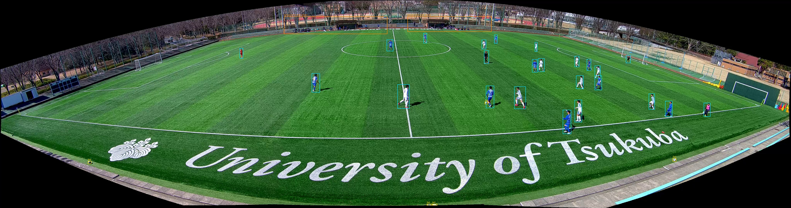

# Kleine gelabelde selectie: panorama 128057

Uit `128057_panorama_1st_half.mp4` is één actief fragment van **00:54 tot 01:14** geselecteerd. Het fragment duurt 20 seconden op 4096 x 1080 en 25 fps. De volledige opname van circa 45 minuten / 3,3 GB blijft lokaal; alleen dit fragment en deze annotaties worden gedeeld.

[Open het videofragment](../../clips20/128057_panorama_1st_half/clip_0054_0074.mp4). De MP4 wordt via Git LFS beheerd: voer na clonen `git lfs pull` uit.

Tijden zijn relatief aan het eerste videobeeld. De oorspronkelijke opname heeft video-PTS vanaf 1 seconde; het gekozen fragment komt daardoor overeen met oorspronkelijke container-PTS 55 tot 75 seconden. Het fragment begint zelf op 0 en bevat exact 500 beelden.



## Wat is gelabeld?

Zes beelden op brontijd **00:55, 00:58, 01:01, 01:04, 01:07 en 01:10**, dus op clipseconden 1, 4, 7, 10, 13 en 16. Dit is bewust een kleine bijdrage aan de grotere challenge-dataset, geen volledige set van 40-80 beelden en geen doorlopend geannoteerde video.

- **143 persoonsboxen**: herkenbare personen op en direct langs het veld, inclusief spelers, keepers en officials. Rollen worden niet als aparte klassen gegokt.
- **29 balboxen**: herkenbare voetballen, inclusief reserveballen buiten de lijnen en twee gedeeltelijk zichtbare reserveballen onderaan de panorama. Het aantal boxen is geen aantal onafhankelijke spelsituaties.
- **Twee crowd/ignore-regio's per beeld** voor moeilijk afzonderlijk te annoteren groepen bij de dugouts aan de overkant. Individuele foregroundlabels krijgen bij overlap voorrang.

De boxen zijn met pretrained YOLO11n voorbereid en door **Codex (AI)** ingezoomd visueel gecorrigeerd. Er zijn onder meer een gemiste speler, een gemiste bal en een overlappende speler toegevoegd; dubbele lichaamsboxen en een rode fles als foutieve bal zijn verwijderd. De zes beelden hebben opgeslagen labels. Een onafhankelijke menselijke review is nog niet uitgevoerd en staat expliciet op `open`.

## Bestanden

- `images/`: zes geselecteerde bronbeelden op volledige resolutie, JPEG quality 100 zonder chroma subsampling.
- `labels/`: YOLO-formaat: `class_id x_center y_center width height`, genormaliseerd op 4096 x 1080. Klasse 0 = `person`, klasse 1 = `ball`.
- `annotations.coco.json`: COCO-boxen met categorie 1 = `person`, 2 = `ball`, plus `iscrowd=1` voor de ignore-regio's.
- `manifest.json`: oorspronkelijke frame-indexen en tijden, cliptijden, bron- en clipchecksums en annotatiestatus. Trek 1350 af van de bronframe-index voor de index in het fragment.
- `previews/`: alle zes beelden met getekende boxen. Cyaan = persoon, geel = bal, oranje = crowd/ignore-regio.
- `corrections.json`: vastgelegde visuele correcties en opmerkingen per beeld.
- `automatic-proposals.json`: ruwe automatische voorstellen, bewaard voor vergelijking.
- `annotation-summary.json` en `review-history.jsonl`: aantallen en transparante annotatiegeschiedenis.
- `verification.json`: uitgevoerde controles, inclusief vergelijking tussen clipframes en geselecteerde bronbeelden.

De gewone YOLO-TXT-bestanden kunnen ignore-regio's niet vastleggen. Gebruik voor beoordeling een evaluator die de COCO-crowdregio's respecteert. Voor YOLO-training moeten die achtergrondgroepen eerst worden gemaskeerd of verder individueel worden gelabeld. Voeg deze zes samenhangende validatiebeelden niet willekeurig toe aan zowel train als val/test.

## Labelregels

Teken een strakke box rond het zichtbare object. Bij overlap label je afzonderlijke herkenbare personen, zonder onzichtbare lichaamsdelen te verzinnen. Bij de twee door de zwarte panoramarand afgesneden ballen omvat de box alleen het zichtbare deel. Een volledig verborgen bal krijgt geen verzonnen locatie. Veldletters, schaduwen, de rode fles en de vlag van de official zijn geen ballen.

De verre dugoutgroepen blijven als crowd/ignore gemarkeerd. Beoordeel deze scope samen met de andere teamannotator voordat je de selectie gebruikt voor een definitieve meting. Dit fragment is geen onafhankelijke wedstrijdbenchmark en er zijn geen modelprestaties uit deze labels berekend.

## Lokaal openen

Vanuit de repository-root, met de projectafhankelijkheden geïnstalleerd:

```powershell
python -m persoon1 annotate --manifest assets/annotations/panorama128057/manifest.json --split val --port 8766
```

Open `http://127.0.0.1:8766`. De opgeslagen boxen worden direct geladen. De crowd-regio's zijn zichtbaar in de previews en COCO-export; de bestaande boxeditor tekent deze niet zelf.

De eenmalige `apply_annotations.py` kan de vastgelegde correcties opnieuw toepassen op een ongewijzigd, nog ongelabeld manifest. Het script weigert bestaande annotaties te overschrijven. Bewaar bij latere correcties ook de COCO-export en previews opnieuw, zodat die met de labels blijven overeenkomen.

`recreate_clip.py` kan een ontbrekend fragment opnieuw maken vanuit het oorspronkelijke bestand; geef het bronpad als argument. Het controleert de bronchecksum en weigert een bestaand fragment te overschrijven. Een andere FFmpeg/libx264-versie kan andere gecodeerde bytes opleveren, ook bij dezelfde bronframes.

## GenAI-disclosure

Gebruikersopdracht: een beperkte selectie uit de aangeleverde video labelen en naar GitHub uploaden. Codex hielp bij selectie, knippen, automatische voorstellen, visuele correctie, export en controle. Annotator is expliciet AI; er zijn geen namen of goedkeuringen van menselijke teamleden ingevuld.
