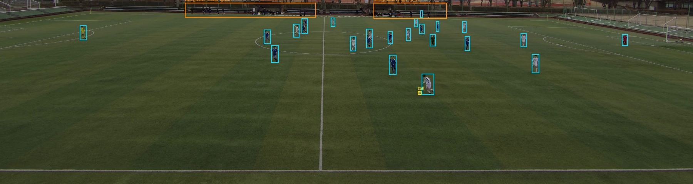

# Gelabelde selectie: TeamTrack 0720-0750

Uit de andere bronvideo `F_20200220_1_0720_0750.mp4` is een [fragment van 20 seconden](../../clips20/F_20200220_1_0720_0750/clip_0000_0020.mp4) gedeeld. De resolutie blijft **6500 x 1000**, met 25 fps. De [volledige bronclip](../../videos/teamtrack/F_20200220_1_0720_0750.mp4) staat al in deze repository.

Drie beelden op **9, 10 en 11 seconden** zijn bewust gekozen omdat de kleine wedstrijdbal daarop visueel herkenbaar is. Dat zijn bronframe-indexen 225, 250 en 275; dezelfde indices gelden in het gedeelde fragment. De bronbestandsnaam verwijst naar wedstrijdseconden 720-750, dus deze beelden liggen op wedstrijdseconden 729, 730 en 731.

## Opgeslagen labels

| Clipseconde | Persoonsboxen | Balboxen |
| --- | ---: | ---: |
| 9 | 26 | 1 |
| 10 | 23 | 1 |
| 11 | 25 | 1 |
| **Totaal** | **74** | **3** |

De aantallen zijn objectinstanties per beeld, geen unieke spelers. `person` omvat herkenbare spelers, keepers, officials en enkele individueel herkenbare personen langs het veld. Rollen worden niet als aparte klassen gegokt. Groepen bij de verre dugouts zijn als twee crowd/ignore-regio's per beeld vastgelegd.

De labels zijn met YOLO11n voorgesteld en door **Codex (AI)** ingezoomd visueel gecorrigeerd. Een gemiste bal op seconde 9 is toegevoegd. Boxen op achtergrond/bomen en een dubbele box rond twee overlappende spelers zijn verwijderd. Bij de overlappende witte en blauwe speler op seconde 11 zijn twee afzonderlijke boxen bewaard en gecorrigeerd. Het reviewveld blijft `open`: er is geen onafhankelijke menselijke goedkeuring ingevuld.



## Bestanden gebruiken

- `images/` en `labels/`: dezelfde bestandsstam koppelt ieder beeld aan zijn opgeslagen YOLO-labels. De beelden zijn JPEG quality 100 zonder chroma subsampling, op bronresolutie.
- **YOLO-klassen:** 0 = `person`, 1 = `ball`. Iedere regel is `class_id x_center y_center width height`, genormaliseerd op de beeldafmetingen.
- `annotations.coco.json`: dezelfde objecten in bronpixels, COCO-categorie 1 = `person`, 2 = `ball`, met aparte `iscrowd=1`-regio's voor de achtergrondgroepen. Reguliere foregroundlabels krijgen bij overlap voorrang.
- `previews/`: alle drie geannoteerde beelden, plus detailuitsneden met voorvoegsel `field_`. Deze uitsneden dienen alleen voor visuele controle; labelcoördinaten blijven op het volledige beeld. Cyaan = persoon, geel = bal, oranje = crowd/ignore-regio.
- `manifest.json`: beeldpaden, bronframe-indexen, clip- en brontijden, bronchecksum, clipchecksum en annotatiestatus.
- `automatic-proposals.json`, `corrections.json`, `review-history.jsonl` en `annotation-summary.json`: ruwe voorstellen, uitgevoerde correcties, herkomst en aantallen.
- `verification.json`: controles van de clip, labelbestanden, beeldkoppeling en export.

Gebruik voor evaluatie de COCO-export met een evaluator die crowd-regio's respecteert. Gewone YOLO-TXT ondersteunt geen ignore-regio's; maskeer de verre groepen of label ze verder individueel voordat je deze volledige beelden voor YOLO-training gebruikt. Het originele fragment bevat geen getekende boxen: de drie bijbehorende beelden zijn gelabeld, niet alle 500 videoframes.

## Lokaal downloaden en openen

Na het ophalen van de laatste repositoryversie:

```powershell
git lfs pull
python -m persoon1 annotate --manifest assets/annotations/teamtrack0750/manifest.json --split val --port 8767
```

Open `http://127.0.0.1:8767`; de opgeslagen boxen worden direct geladen. De crowd-regio's staan in de COCO-export en previews; de bestaande editor tekent ze niet zelf. De eenmalige `apply_annotations.py` bewaart de vastgelegde correcties vanuit een ongelabeld manifest en weigert bestaande labels te overschrijven. Werk bij latere edits ook de COCO-export en previews bij.

Alle drie beelden behoren tot dezelfde temporele groep en staan op `val`, zoals de oorspronkelijke bronselectie. Verdeel deze nabije momenten niet willekeurig over train, val en test. Dit is een kleine, gerichte bijdrage aan de totale challenge-dataset, geen volledige set van 40-80 beelden of onafhankelijke wedstrijdbenchmark.

## Labelregels en AI-gebruik

Omsluit het zichtbare object strak en verzin bij occlusie geen onzichtbare omtrek. Behoud twee afzonderlijk herkenbare overlappende personen als aparte instanties. Alleen visueel herkenbare voetballen krijgen `ball`; witte letters, geschilderde cirkels en schoenen zijn geen ballen. Onduidelijke balmomenten uit de eerste selectie zijn niet in deze beperkte selectie opgenomen.

De gebruiker vroeg een andere video te labelen en de bestanden te pushen zodat het team ze kan gebruiken. Codex verzorgde bronselectie, automatische voorstellen, visuele correcties, export en controle. De annotator staat als AI geregistreerd; menselijke teamleden moeten hun eigen review uitvoeren en registreren.
