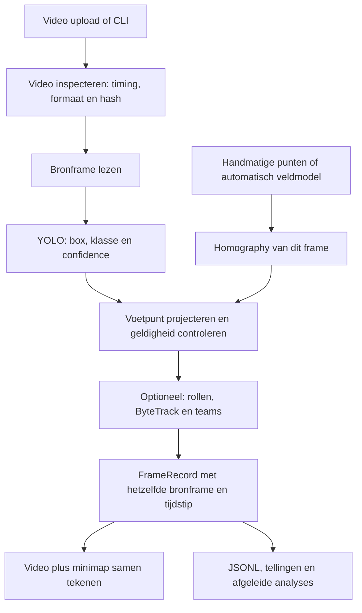

# De code begrijpen en verdedigen

Deze leesgids beschrijft de implementatie op de branch `codex/code-uitleg-verdediging`.
De [technische controle](Code_Uitleg_Controle.md) vermeldt de daadwerkelijk uitgevoerde tests en omgeving.
Begin met de schoolbasis en voeg daarna de uitbreidingen toe die jullie werkelijk
demonstreren. Het [bestandenoverzicht](Codekaart.md) verwijst naar **ieder gevolgd
codebestand**, met functies, lokale afhankelijkheden en een onderscheid tussen
toepassing, experiment, test en historische bronkopie. Bovenaan de Python-modules
van beide pakketten staat ook een Nederlandse uitleg.

Iedere benoemde Python-functie in de actuele toepassing, modelcode, scripts en
datasethelpers heeft een docstring, ook methoden, properties en geneste callbacks.
Er zijn 618 functies in 168 bronbestanden gecontroleerd. Bestaande inhoudelijke
Engelse functie-uitleg is behouden; ontbrekende uitleg is in het Nederlands aangevuld.
Tests en historische bronkopieën onder `reports` vallen buiten deze productiedekking.
Controleer dit met `python scripts/check_function_docs.py`; de CI voert dezelfde
controle uit. De controle meet aanwezigheid, geen automatische garantie van juistheid.

De argumenten hieronder zijn technische afwegingen van de bestaande implementatie.
Ze bewijzen niet dat een alternatief in een eigen vergelijkende proef slechter was.
Voor zo'n historische claim is een werkelijk experiment nodig. Gebruik daarvoor de
gekoppelde rapporten en modelkaarten, niet een achteraf bedachte verklaring.

## 1. Wat lossen we op?

We zetten een voetbalvideo om naar detecties en een bovenaanzicht van het veld.
Het systeem voorspelt eerst waar objecten in **beeldpixels** staan. Daarna berekent
geometrie waar een grondpunt op het **veldvlak** ligt. Optioneel koppelen we spelers
door de tijd, delen we ze in teams in en schatten we waargenomen afstanden.

Dat zijn verschillende taken. Een goede box bewijst geen goede veldpositie. Een
stabiel track-ID bewijst geen juiste teamindeling. We bewaren de tussenresultaten
om fouten aan de juiste stap te kunnen toewijzen.



**Schoolbasis:** [Start-School.ps1](../scripts/Start-School.ps1) zet de schoolmodus
aan, kiest [models-school.json](../configs/models-school.json) en start
[streamlit_app.py](../streamlit_app.py). Dat profiel gebruikt P006 voor spelers en
scheidsrechters en F005 voor ballen, beide op volledige beelden. De standaard
schoolworkflow gebruikt handmatige kalibratie zonder teams of tracking.
`-BroadcastTiles` kiest expliciet een ander modelprofiel met baltegels.

**Uitgebreide analyse:** de andere startcommando's kunnen automatische veldmodellen,
rolclassificatie, teamkenmerken en tracking inschakelen. Controleer het werkelijk
geladen profiel en het opgeslagen runmanifest. Een model uit een oud README-bericht
is niet noodzakelijk het model dat een nieuwe run gebruikt.

## 2. De drie soorten coördinaten

| Vorm | Voorbeeld | Betekenis en toepassing |
| --- | --- | --- |
| Bronbox `xyxy` | `[100, 50, 140, 130]` | Linksboven en rechtsonder in oorspronkelijke beeldpixels. Detectie en tracking bewaren deze vorm. |
| YOLO-label | `0 0.50 0.40 0.10 0.20` | Klasse, centrum-x, centrum-y, breedte en hoogte, gedeeld door de beeldafmetingen. Alleen datasetrepresentatie. |
| Veldpunt `(u,v)` | `(0.5, 0.25)` | Genormaliseerde positie over veldlengte en veldbreedte. Geen schermpixel en op zichzelf geen meter. |

Bij een beeld van 1000 × 500 betekent het voorbeeldlabel een box van 100 × 100
pixels rond `(500,200)`, dus `xyxy = [450,150,550,250]`. Die conversie is geen
homography: de homography komt pas bij beeld-naar-veldprojectie.

OpenCV leest doorgaans BGR-beelden; PIL gebruikt RGB. Kleurfuncties zetten dit
expliciet om. Het verwisselen van breedte/hoogte of BGR/RGB kan een programma laten
draaien terwijl de uitkomst onjuist is. De contracten en tests controleren daarom
meer dan alleen of er een bestand wordt geproduceerd.

## 3. Detectie: waarom YOLO en meerdere gewichten?

[detection.py](../src/football_pipeline/detection.py) bevat de runtimeadapter;
[persoon1/modeling.py](../persoon1/modeling.py) bevat training en data-evaluatie.
YOLO voorspelt bounding boxes en klasseconfidence. De Ultralytics-bibliotheek voert
de netwerkberekening en bijbehorende nabewerking uit. Wij hebben YOLO niet zelf
ontworpen: onze bijdrage zit in data, training, instellingen, adapters en integratie.

De profielbestanden leggen per model gewichten, checksum, bronklassen, semantische
mapping, invoerformaat, confidence, NMS-IoU en device vast. `expected_names`
controleert dat een bronklasse werkelijk de verwachte betekenis heeft. Klasse 0
van een spelersmodel kan `player` zijn, terwijl klasse 0 van een COCO-model `person`
is. Een algemene persoon kan ook een steward of supporter zijn.

De confidencegrens filtert voorspellingen. Een hogere grens kan foutmeldingen
verminderen maar ook echte objecten verwijderen. Confidence is een modelscore,
geen garantie dat bijvoorbeeld 80% van alle voorspellingen met score 0,8 klopt.
**NMS** houdt bij sterk overlappende voorspellingen van dezelfde taak de sterkere
over en vermindert zo dubbele boxen. Confidence en IoU zijn verschillende drempels.

| Keuze | Verdedigbare afweging | Alternatief en grens van onze kennis |
| --- | --- | --- |
| YOLO met transfer learning | Bestaande detectiegewichten en een training/inferentie-interface passen bij beperkte gelabelde voetbaldata. | Faster R-CNN of DETR zijn ook mogelijke detectors. Er is hier geen volledige vergelijking die hun superioriteit of inferioriteit bewijst. |
| Afzonderlijke speler- en balgewichten | De reeds getrainde specialisten hebben verschillende labeltaken en kunnen apart worden verbeterd. | Eén gezamenlijk model kan eenvoudiger in gebruik zijn, maar vraagt harmonisatie van de klassen, data en een nieuwe vergelijking. Twee modellen kosten extra inferentie. |
| Eigen voetbaldata | Kleine ballen, afwijkende camerahoeken en officials wijken af van algemene voorbeelden. | Alleen een algemeen model gebruiken vraagt minder annotatiewerk maar lost die domeinverschillen niet aantoonbaar op. |
| CPU en expliciete CUDA-keuze | CPU ondersteunt technische controles; GPU ondersteunt zware verwerking en training. | We beloven geen realtime verwerking of bepaalde versnelling zonder tijdmeting op dezelfde hardware. |

Een optionele rolclassifier bekijkt persoonscrops na detectie. Een goede
cropclassificatie is geen detectiescore: zonder een juiste eerste box kan de tweede
stap een gemiste persoon niet herstellen. Sommige profielen gebruiken ook
veldcontext. Dat zijn andere informatiebronnen dan uitsluitend beeldherkenning.

De aanvullende beeldencoder in `appearance.py` is **MobileNetV3 Small** uit
torchvision. De oorspronkelijke classificatielaag wordt vervangen: de encoder
levert 576 kenmerken, waaraan 32 HSV-histogramkenmerken worden toegevoegd. De
608 waarden gaan naar getrainde lineaire rol- en teamkoppen; opgeslagen gemiddelden
en standaardafwijkingen normaliseren de invoer. Softmax zet de logits om naar
onderlinge klassescores. De oorspronkelijke encoder kan ImageNet-startgewichten
gebruiken; runtime laadt de werkelijk opgeslagen eigen toestand.

Het voordeel van deze opzet is dat bestaande cropkenmerken kunnen worden
hergebruikt en de aanvullende kop afzonderlijk te begrijpen is. Een groter netwerk
of een transformer is een mogelijk alternatief, maar er is geen volledige eigen
vergelijking die aantoont dat die hier slechter is. Bij fine-tuning kunnen sommige
encoderlagen worden vastgezet of weer vrijgegeven; de experimentinstellingen
bepalen welke variant werkelijk is uitgevoerd.

Let bij teammodellen op het checkpointformaat: `broadcast-kit-v1` gebruikt een
encoder met een projectiekop van 608 → 128 → 32 kenmerken. `broadcast-kit-hist-v2`
gebruikt aangeleerde positieve gewichten voor 32 kleurkenmerken en heeft die CNN
bij deze stap niet nodig. Optionele `role_context` is weer een ander, klein
neuraal netwerk: het combineert cropbeslissingen met relatieve shirtgelijkenis,
boxgrootte en gekalibreerde posities. Zo'n contextmodel is geen nieuwe YOLO-detector
en kan niet zinvol worden uitgelegd alsof het alleen naar een losse foto kijkt.

## 4. Waarom baltegels?

Een volledige panoramafoto wordt voor inferentie verkleind. Een bal van enkele
pixels kan daardoor veel detail verliezen. [ball_tiles.py](../src/football_pipeline/ball_tiles.py)
verwerkt overlappende uitsneden met meer oorspronkelijk detail. Voor een lokale box
`[x1,y1,x2,y2]` in een tegel op `(dx,dy)` worden de broncoördinaten
`[x1+dx,y1+dy,x2+dx,y2+dy]`.

Overlap voorkomt dat een object op een tegelrand steeds wordt afgesneden. Dezelfde
bal kan dan in twee tegels voorkomen; daarom volgt een globale NMS. De laatste
tegel wordt expliciet tegen de beeldrand gezet, ook als de stap daar niet exact
uitkomt. Meer tegels betekenen meer modelaanroepen. Alleen vergroten creëert geen
nieuw beelddetail. Tegel- en volledige-beeldscores mogen alleen worden vergeleken
met dezelfde referenties en expliciet beschreven inferentie-instellingen.

Een ballabel bepaalt niet automatisch welke bal in het spel is. De nieuwe
[broadcast-new100-set](../assets/annotations/broadcast-new100/README.md) heeft een
aparte speelbaldefinitie; andere datasets labelen ook reserveballen. Klasse-ID's
gelijkmaken zonder de taakdefinitie te controleren zou foutieve training geven.

## 5. Homography: hoe komen punten op de minimap?

[geometry.py](../src/football_pipeline/geometry.py) schat uit vier puntparen een
3 × 3-matrix `H`. Elk paar koppelt een aangeklikte bronpixel `(x,y)` aan een bekende
veldpositie `(u,v)`. We gebruiken de perspectiefrelatie:

```text
[a, b, c] = H @ [x, y, 1]
u = a / c
v = b / c
```

De matrix heeft acht onafhankelijke vrijheidsgraden doordat een gemeenschappelijke
schaalfactor dezelfde projectie geeft. Vier niet-degeneratieve puntparen leveren
acht coördinaatvoorwaarden. Kruisende, te dicht opeenliggende of ongeldige punten
worden geweigerd. De schoolbasis gebruikt `findHomography(..., method=0)`: met
precies vier aangeklikte fitpunten levert RANSAC geen extra onafhankelijke controle.
Bij grotere aantallen automatisch herkende punten is robuuste uitschieterselectie
wel een relevante aparte stap.

Minstens twee andere punten dienen als **controle**, niet als fitinvoer. Via de
inverse matrix worden hun bekende veldposities terug naar beeldpixels geprojecteerd
en met de klikken vergeleken. De gekozen foutgrenzen zijn 0,5% mediaan en 1% maximum
van de beelddiagonaal. Dat zijn acceptatiegrenzen van dit project, geen bewezen
algemene nauwkeurigheid of 3D-meting.

Voor spelers nemen we het midden onderaan de box als benadering van grondcontact.
Het boxcentrum ligt meestal op het lichaam en past slechter bij de aanname van een
vlak veld. Ook het voetpunt blijft een benadering: een slechte box geeft een slechte
positie. Onderaf afgesneden boxen en ongeldige projecties blijven onbekend; we
duwen zulke punten niet kunstmatig naar de dichtstbijzijnde veldrand.

Waarom geen gewone schaalfactor? Perspectief maakt dezelfde afstand in pixels
afhankelijk van de plaats in het beeld. Een homography beschrijft dat voor één vlak.
Een volledige 3D-reconstructie vraagt meer camera-informatie en lost een andere
taak op. Een vliegende bal ligt buiten onze grondvlakveronderstelling. We kunnen
daarvoor geen betrouwbare 3D-positie of hoogte verdedigen.

Bij een vaste camera kan één matrix bij de clip horen. Bij pan, zoom of een cut
kan dat niet zomaar. De automatische uitbreiding gebruikt veldpunten/lijnen per
frame en beperkt gemeten bewegingspropagatie. Bij onvoldoende bewijs ontbreekt de
veldpositie. De PnLCalib-runtime draait apart omdat de externe modelcode eigen
dependencies heeft. [Automatische veldkalibratie](Automatische_Veldkalibratie.md)
beschrijft die uitbreiding en [veldvergelijking](Veldherkenning_Betrouwbaarheid.md)
de gemeten beperkingen. Automatische controlepunten zijn geen menselijke waarheid.

## 6. Tracking en camerabeweging

[tracking.py](../src/football_pipeline/tracking.py) past ByteTrack toe op actuele
spelerboxen. ByteTrack gebruikt bewegingsvoorspelling en associatie; lagere
confidencekandidaten kunnen een bestaand spoor helpen voortzetten. Daarom mag
de detector ze niet allemaal al wegfilteren voordat de tracker ze ziet.

Een Kalman-toestand voorspelt beweging, maar een voorspelde locatie is niet
automatisch een nieuwe zichtbare speler. Onze uitvoer koppelt track-IDs terug aan
actuele detectie-indices. Trajectlijnen verbinden alleen opeenvolgende geldige
waarnemingen. Bij een gat wordt geen gelopen route verzonnen.

De compatibiliteitsadapter `_IndexedBoxes` bewaart de oorspronkelijke indices bij
het opsplitsen in confidencegroepen in Ultralytics 8.3.221. Dat ziet er ingewikkeld
uit, maar beschermt tegen het koppelen van een track aan de verkeerde detectie.
Het is versiegebonden gedrag met tests; die adapter zomaar verwijderen is geen
verantwoorde vereenvoudiging.

[tracking_motion.py](../src/football_pipeline/tracking_motion.py) meet optioneel de
achtergrondbeweging, met spelers gemaskeerd. Anders kan een camerapan als
spelersbeweging worden geïnterpreteerd. Bij cuts of onbetrouwbare metingen starten
nieuwe tijdelijke IDs. Dit herkent geen spelersnamen en garandeert geen identieke
ID na een lange occlusie.

ByteTrack past bij boxen en confidence die we al hebben. Een alternatief zoals
DeepSORT voegt appearance-associatie toe, met extra model-, reken- en afstelwerk.
Deze repository bewijst geen algemene winst van de ene tracker boven de andere.
Betrouwbare trackingvergelijking vraagt aparte menselijke trajectreferenties.

## 7. Teams, telling en afstanden

[teams.py](../src/football_pipeline/teams.py) gebruikt shirtcrops en onder meer
Lab-kleuren; [video_teams.py](../src/football_pipeline/video_teams.py) bevat een
afzonderlijke HSV-kleurroute. Andere profielen gebruiken een getrainde
[kit embedding](../src/football_pipeline/kit_embedding.py). De methoden zijn dus
niet onderling verwisselbare namen voor precies hetzelfde algoritme.

De kleurroute zoekt dominante shirtgroepen in de huidige wedstrijd en gebruikt
afstand, scheiding en herhaalde waarnemingen om labels te stabiliseren. A/B zijn
neutrale namen, geen herkende clubidentiteiten. De embeddingroute leert een
kenmerkruimte uit gelijk/verschillend-teamparen. Daarin liggen passende
shirtvoorbeelden hopelijk dichter bijeen; de werkelijke kwaliteit vraagt meting.

Waarom niet simpelweg 'rood = team A'? Andere wedstrijden hebben andere shirts,
lichtomstandigheden en doelmankleuren. Waarom niet ieder punt verplicht aan een
team toewijzen? Bij onvoldoende scheiding zou dat schijnzekerheid geven. Een
onbekende teamstatus is een geldige uitkomst. Een teamafstand of kleurmarge is
geen gekalibreerde kans.

[participants.py](../src/football_pipeline/participants.py) bewaakt één gedeelde
telregel. Een echte `player`-rol, geldige projectie en de geldende zichtbaarheids-
en confidencevoorwaarden zijn nodig om mee te tellen. Een onbekende veldkalibratie
is geen bewijs van nul spelers op het veld.

[distances.py](../src/football_pipeline/distances.py) vermenigvuldigt veldposities
met expliciet vastgelegde veldafmetingen, of vermeldt de aanname van 105 × 68 m.
Het onderbreekt trajecten bij ontbrekende waarnemingen, resets en onwaarschijnlijke
sprongen, gebruikt een korte mediaanfilter en meet in tijdstappen. Anders kan
detectiejitter onterecht als gelopen afstand worden opgeteld. De uitvoer bevat
meetdekking: een gedeeltelijk waargenomen traject is geen totale wedstrijdafstand.

## 8. Data en training verdedigen

De datatools staan in [persoon1](../persoon1) en de `*_dataset.py`-modules.
Een manifest koppelt beeld, labels, bron, tijdstip, split en reviewstatus. YOLO-TXT
en COCO-JSON zijn representaties van labels; geen van beide bewijst labelkwaliteit.
AI-voorstellen en providerlabels blijven onderscheiden van onafhankelijke
menselijke review. Een leeg label is pas een negatief voorbeeld als de doelobjecten
werkelijk afwezig zijn. Een onvindbare speelbal is geen bewezen negatieve balfoto.

Videoframes lijken sterk op hun buren. Willekeurig naburige frames verdelen kan
train- en validatiescores te optimistisch maken. Waar de datasets dit ondersteunen
houden we wedstrijden, clips of tijdgroepen gescheiden. De precieze split staat
in iedere datasetversie. Een nieuwe externe bron is niet automatisch onafhankelijk
van de oorspronkelijke trainingsdata van een vooraf getraind voorstelmodel.

Fine-tuning start met bestaande gewichten. De loss vergelijkt voorspellingen met
trainingslabels; backpropagation berekent gradiënten en de optimizer past gewichten
aan. Een epoch doorloopt de trainingsset; een batch bepaalt hoeveel beelden samen
een stap vormen. Learning rate, augmentatie, bevroren lagen en early stopping
beïnvloeden het leren. **De precieze lossvariant en optimizer komen uit de
gebruikte modelversie en experimentconfiguratie**; zeg niet dat we zelf één vaste
YOLO-loss of overal dezelfde optimizer hebben geschreven.

Training wijzigt gewichten; validatie ondersteunt model- en instellingenkeuze.
De finale test blijft buiten beide stappen. Het hernoemen van een ontwikkelset
naar 'test' maakt die niet onafhankelijk. Grote verzamelde datasets zijn evenmin
bewijs dat elk huidig profiel daarop opnieuw is getraind.

Lees voor werkelijk uitgevoerde keuzes de [cursusvergelijking](Modelverbetering_Volgens_Cursus.md),
[baltraining v2](Broadcast_V2_Training.md), [baltraining v3](Verbeteringen_20261028.md)
en de modelkaart van het gebruikte gewichtsbestand. Controleer steeds bronset,
modelhash, invoerformaat en meetmethode voordat je scores naast elkaar zet.

## 9. Wat meten de scores?

| Begrip | Uitleg |
| --- | --- |
| IoU | Oppervlakte van de boxdoorsnede gedeeld door de oppervlakte van de vereniging. |
| Precision | `TP / (TP + FP)`: welk deel van de getelde voorspellingen correct gekoppeld is. |
| Recall | `TP / (TP + FN)`: welk deel van de referentieobjecten gevonden is. |
| AP@50 | Oppervlakte onder de precision-recallcurve bij IoU 0,50 volgens de gekozen evaluator. |
| AP@50:95 | Gemiddelde AP over IoU 0,50 t/m 0,95 in stappen van 0,05. Strengere boxplaatsing telt mee. |
| mAP | Gemiddelde AP over de geëvalueerde klassen; vermeld welke klassen en welke evaluator. |

AP varieert de scoregrens om de curve te maken. Een losse precision/recall bij
confidence 0,25 is dus iets anders. Voor één label mag niet iedere overlappende
voorspelling een extra true positive worden; één-op-één koppeling is noodzakelijk.
Onvolledige labels kunnen echte objecten onterecht tot false positives maken.

[persoon1/metrics.py](../persoon1/metrics.py) bevat een expliciete 101-punts
AP-implementatie voor de beschreven datasetvoorwaarden. Andere experimenten
gebruiken de bibliotheekevaluator. [evaluation.py](../src/football_pipeline/evaluation.py)
telt eigen trackinggebeurtenissen. Noem die laatste niet zonder meer HOTA, IDF1 of
een officiële MOT-score. Kalibratiefouten in pixels meten weer iets anders dan
detectie-AP, trajectidentiteit of teamnauwkeurigheid.

## 10. Welke software gebruiken we en waarom?

| Onderdeel | Gebruik | Afweging tegenover een mogelijk alternatief |
| --- | --- | --- |
| Python | Verwerking, training en scripts. | Past bij de gebruikte ML-bibliotheken; C++ zou een andere implementatie en onderhoud vragen. Geen gemeten taalbenchmark. |
| PyTorch / torchvision | Tensorberekeningen, transfer learning en aanvullende classifiers. | Sluit aan op de gewichten en modelcode; TensorFlow zou adapters en andere compatibiliteitscontroles vragen. |
| Ultralytics | YOLO-training, inferentie en ByteTrack-integratie. | Minder eigen infrastructuur; bibliotheekversies en mappings moeten expliciet gecontroleerd blijven. |
| OpenCV | Frames, perspectieftransformaties, camerabeweging en tekenen. | Biedt de benodigde geometrie en beeldfuncties; PIL blijft nuttig voor datasetbeelden en reviewvellen. |
| NumPy / SciPy | Matrixberekeningen, afstanden en toewijzing. | Geteste vectorfuncties vermijden handmatige pixel- en matrixlussen; dat maakt foute coördinaten niet automatisch goed. |
| Streamlit / pandas | Lokale interface, tabellen en inspectie. | Weinig aparte webinfrastructuur voor een lokale demo; een React/backendopzet geeft meer UI-vrijheid maar vraagt extra bouw- en communicatielagen. |
| FFmpeg / ffprobe | Video coderen en alle frametijdstippen controleren. | Metadata en H.264-uitvoer zijn expliciet te controleren; alleen een OpenCV-fpswaarde bewijst geen constante timing. |
| PyAV | Bronframes met echte presentatietijden voor data-extractie. | Ondersteunt de dataroute voor VFR; de sequentiële app stelt bewust strengere timingvoorwaarden. |
| JSON / JSONL / YAML | Manifesten, één record per frame en configuraties. | Leesbaar en diffbaar zonder databaseserver; grote JSONL-bestanden vragen wel zorgvuldig sequentieel lezen. |
| Git / Git LFS | Code- en versietracking, grote gedeelde gewichten en toegestane media. | Een bronhash bewijst bestandsidentiteit, geen toestemming of labelnauwkeurigheid. Sommige bronnen blijven buiten Git. |
| pytest / Ruff | Gedragstests, statische controles en vaste formattering. | Softwarecontroles zijn herhaalbaar; modelkwaliteit op nieuwe wedstrijden vereist een andere evaluatie. |

`pyproject.toml` ondersteunt Python 3.11/3.12. Requirements- en lockbestanden
beschrijven verschillende omgevingen: CPU-toepassing, training en geïsoleerde
veldcode. Installeer die niet blind boven op elkaar. Versies uit een lockbestand
zijn een reproductiedoel; de werkelijk gebruikte omgeving en hashes worden in
runmanifesten vastgelegd. Voor een praktische demonstratie controleer je eerst de
gekozen startprocedure en beschikbare modelbestanden.

## 11. Waarom zoveel controle- en uitvoercode?

[pipeline.py](../src/football_pipeline/pipeline.py) vormt de orkestratie.
[contracts.py](../src/football_pipeline/contracts.py) definieert de gedeelde records.
De interface gebruikt dezelfde functies als de CLI, zodat ze geen tweede versie
van de berekeningen hoeft te bevatten.

Eén samengesteld uitvoerframe bevat video en minimap. Twee onafhankelijke spelers
zouden apart kunnen pauzeren of zoeken. De samengestelde video voorkomt dat
synchronisatieprobleem. Per bronframe bewaart JSONL dezelfde detecties, projecties,
status en tijd. Teamcorrecties kunnen daardoor een afgeleide uitvoer maken zonder
opnieuw detectie te doen.

Een cachekey bevat de video, instellingen, modellen, code en afhankelijkheden.
Alleen dezelfde naam of resolutie gebruiken zou verkeerde resultaten kunnen
hergebruiken. Uitvoerhashes toetsen bovendien of bestanden intussen veranderd zijn.
Tijdelijke bestanden en atomair vervangen voorkomen half geschreven JSON voor
lezers; een proceslock voorkomt gelijktijdig schrijven in dezelfde uitvoermap.
`try/finally` sluit videolezers en processen ook bij fouten.

Deze administratie helpt aantonen **wat** is uitgevoerd. Ze keurt geen labels of
modelresultaten goed. Synthetische fixtures en technische pilots krijgen daarom
geen menselijke reviewstatus of voetbalbenchmarkscore.

## 12. Wat is vereenvoudigd en wat moet behouden blijven?

Op deze branch zijn twee opeenvolgende identieke guards rond de
appearanceverwerking in `UltralyticsDetector.detect` samengevoegd tot één blok.
De volgorde blijft: eerst persoonsvoorstellen samenvoegen, daarna classificeren.
Dit vermindert herhaling zonder een nieuwe herkenningsstrategie te introduceren.

De versieadapter voor ByteTrack, afzonderlijke veldruntime, expliciete klassemappings
en uitsluitingen van onzekere labels blijven behouden. De codekaart maakt hun rol
zichtbaar. Ze weghalen omdat ze lang ogen zou reële voorwaarden van de pipeline
verbergen. Historische bronkopieën onder `reports` blijven ongewijzigd: die leggen
vast welke implementatie bij een oude meting hoorde.

## 13. Vragen voor een mondelinge verdediging

1. **Wat hebben jullie zelf gemaakt?** Data en annotatiekeuzes, eigen trainingen
   en vergelijkingen, coördinatenadapters, veldprojectie, integratie, interface en
   controles. YOLO, PyTorch, ByteTrack en PnLCalib zijn bestaande technieken.
2. **Waarom is een persoon op het veld geen bewezen speler?** Geometrie zegt waar
   iets staat; de rol komt van een model of labeldefinitie. Staf kan ook op het veld staan.
3. **Waarom past de kalibratie niet altijd?** Foute punten, weinig spreiding,
   lensvervorming, pan/zoom of een onbetrouwbare automatische herkenning.
4. **Waarom tellen we soms minder dan 22 spelers?** De camera toont niet altijd
   iedereen; daarnaast missen detectors objecten en weigert de pipeline ongeldige posities.
5. **Welke fout is duurder, een gemiste bal of een reservebal?** Dat hangt van de
   expliciete taak af. Verdedig de gekozen labeldefinitie en drempel met een passende meting.
6. **Waarom is een resultaat niet gegarandeerd op een nieuwe wedstrijd?** Kits,
   camera, resolutie, licht en dataverdeling kunnen afwijken; onafhankelijke tests ontbreken soms.
7. **Hoe weten jullie welke versie een resultaat maakte?** Het runmanifest bewaart
   model- en videohashes, instellingen, broncode-identiteit en packageversies.
8. **Wat zouden jullie eerst verbeteren?** Inspecteer echte fouten op een
   afgeschermde evaluatieset en kies gericht data of een enkele wijziging. Meer
   epochs of een ingewikkelder netwerk is zonder zo'n diagnose geen onderbouwde oplossing.

Laat ieder teamlid tijdens het oefenen één frame volgen: bronpixel → box →
voetpunt → veldpunt → optioneel track/team → getekend uitvoerframe. Toon daarna
één fout en verklaar in welke stap die ontstond. Dat is sterker bewijs van begrip
dan alleen een werkende video afspelen.
