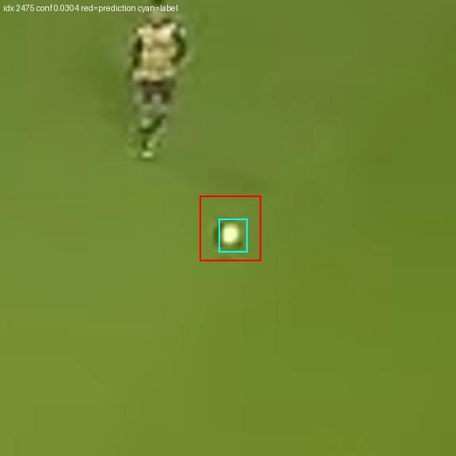
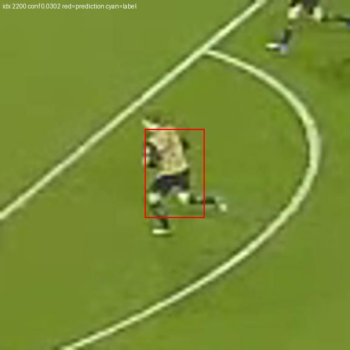
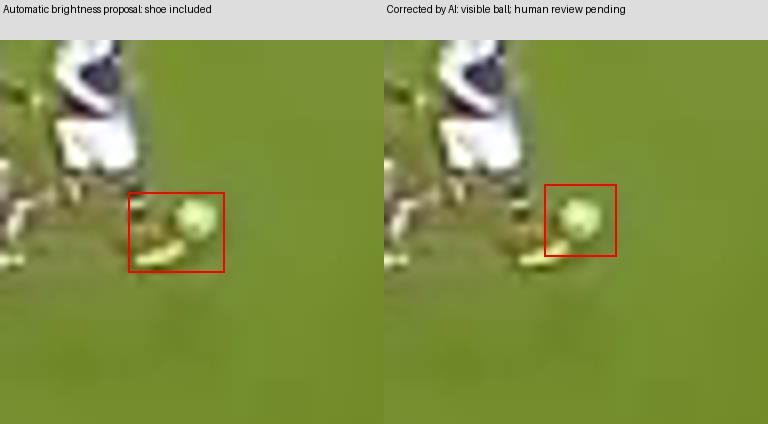

# Werkelijke fine-tuning en projectmetingen — persoon 1

**Uitgevoerd op 16 oktober 2026.** Twee echte trainingsruns op de gekozen voetbalvideo zijn afgerond, met checkpoints, logs, curves en afzonderlijke projectmetingen. Geen van beide verbetert de validatiescore. De labels zijn visueel door AI gecontroleerd; onafhankelijke menselijke teamreview staat nog open. Dit zijn **voorlopige ontwikkelresultaten**, geen goedgekeurde onafhankelijke eindtest.

## 1. Data en modelrollen

De bron is de door de gebruiker gekozen [PANORIS-video](https://www.youtube.com/watch?v=HBTFZwMdcCw), ongewijzigd op 3840 × 960 pixels. Bronhash: `7990708af29a660f089a204b9a39ad16c5ebf9063ed1eaf0ee325c01bbdda611`.

Van de oorspronkelijke selectie zijn 34 beelden met een lokaliseerbare bal behouden. Er kwamen 13 trainingsbeelden op 0,2 seconde na een helder trainingsmoment bij. Nabije beelden blijven in dezelfde groep. De overige 26 kandidaten zijn uitgesloten wegens onvoldoende zekere lokalisatie; ze zijn niet als negatief gelabeld.

| Subset | Frames | Balobjecten | Tijdgroepen | Menselijk gereviewd |
|---|---:|---:|---:|---:|
| Train | 27 | 27 | 5 | 0 |
| Validatie | 12 | 12 | 2 | 0 |
| Gereserveerde test | 8 | 8 | 2 | 0 |
| Totaal | 47 | 47 | 9 | 0 |

De tijdgroepen zijn vóór inference gereserveerd. De dataset bevat alleen positieve, visueel lokaliseerbare balsituaties. Hij meet geen prestaties op verborgen ballen of werkelijk negatieve frames. De dertien extra beelden vormen geen dertien onafhankelijke spelsituaties. De globale beeldvergelijking waarschuwt voor overeenkomst tussen alle subsets door hetzelfde veld en dezelfde achtergrond. Deze waarschuwing en de actie-inhoud vereisen nog teamreview. De resultaten ondersteunen geen claim over andere wedstrijden of camera's.

De ontwikkelroute gebruikt een **afzonderlijke baldetector** en behoudt de pretrained personendetector. Daardoor hoeft geen onvolledig geannoteerde personenklasse te worden meegetraind. `person` betekent een mens; speler- en scheidsrechterrollen zijn niet afzonderlijk herkend of gemeten.

De [selectie met pixelboxen](../datasets/panoris-ball-ai-v1/selection.json), [YOLO-labels](../datasets/panoris-ball-ai-v1/labels), [boxregels](../datasets/panoris-ball-ai-v1/README.md) en [visuele controle](../datasets/panoris-ball-ai-v1/review) zijn versieerbaar. De bronframes, contextuitsneden en het uitvoerbare manifest worden vanuit de bronvideo opnieuw opgebouwd.

## 2. Echte training en voorbewerkingsprobleem

Beide runs begonnen opnieuw met officiële `yolo11n.pt`-gewichten, niet met de synthetische softwareproef. Referentie-instellingen: Adam, learning rate 0,001, eindfactor 0,01, maximaal 100 epochs, patience 20, freeze 10, AMP, seed 42, deterministisch aan en alleen horizontaal spiegelen als augmentatie. Volledige werkelijke instellingen staan per run in `args.yaml`.

| Run | Invoer tijdens training | Batch | Epochs uitgevoerd | Trainingstijd uit CSV | Uitkomst |
|---|---|---:|---:|---:|---|
| EXP-001 | 640, vierkante padding | 4 | 100 | 308,068 s | Alle balboxen verdwijnen uit de trainingsvoorbewerking |
| EXP-002 | 1920, rechthoekige padding | 4 | 100 | 542,433 s | Balboxen blijven behouden; geen validatiewinst |

Er trad geen batchterugval wegens GPU-geheugentekort op. Werkelijke hardware: **RTX 3050 Laptop GPU, 4 GB**. Dit zijn geen RTX 4050-metingen en geen volledige videopipeline-benchmarks. De tijden betreffen training volgens het framework, niet installatie, selectie en alle losse evaluaties.

**Bij 640 gaat het concreet mis:** de vastgezette Ultralytics-versie verwijdert tijdens training getransformeerde boxen waarvan breedte of hoogte niet groter dan twee pixels is. Dat gebeurt ook bij nulwaarden voor geometrische augmentatie. Na verkleinen van deze panorama blijven bij 640 nul van de 27 trainingsboxen over. De log toont daarom nul effectieve instanties en nul box- en DFL-loss. Het netwerk werkt classificatiegewichten bij, maar krijgt geen bruikbare balboxsupervisie. De run is een negatief resultaat.

Op 960 zouden slechts **4 van 27** boxen de groottefilter passeren; op 1920 **27 van 27**. Dat onderbouwde EXP-002. Rechthoekige batches beperken padding en geheugenverbruik, maar schakelen in deze frameworkversie ook shuffle uit. De wijziging is daarom een praktische configuratievergelijking met meerdere gevolgen, geen zuiver causaal experiment met uitsluitend één gewijzigde resolutie.

De instellingen leggen ook defaults vast: `nbs=64`, nominaal 16 accumulatiestappen bij batch 4 na warmup, en minimaal 100 warmup-iteraties in deze versie. Met zeven batches per epoch duurt de feitelijke warmup langer dan alleen drie epochs. Patience is 20; bij voortdurend nulfitness herzet deze versie de vroege nulfitnessfase. Daarom liepen beide runs werkelijk alle 100 epochs door. Bronversie, instellingen en curves zijn bewaard.

Leercurves: [EXP-001 op 640](../reports/ball-experiments/EXP-001-ball-640-curves.png) en [EXP-002 op 1920](../reports/ball-experiments/EXP-002-ball-1920-curves.png).

## 3. Vergelijkbare validatiemetingen

Alle rijen gebruiken **dezelfde twaalf validatieframes met twaalf balboxen**, dezelfde klassebetekenis en dezelfde evaluator. Pretrained `sports ball` wordt expliciet gekoppeld aan `ball`; de specialist gebruikt lokaal klasse-ID 0 met de naam `ball`. Personen tellen niet mee.

| Model | Trainingsresolutie | Inferentieresolutie | mAP@50 | mAP@50:95 | Precision bij 0,25 | Recall bij 0,25 |
|---|---|---:|---:|---:|---:|---:|
| Pretrained baseline | Oorspronkelijke pretraining | 640 | 0,00% | 0,00% | 0,00 | 0,00 |
| EXP-001 | 640 | 640 | 0,00% | 0,00% | 0,00 | 0,00 |
| EXP-002 | 1920 | 640 | 0,00% | 0,00% | 0,00 | 0,00 |
| Pretrained baseline | Oorspronkelijke pretraining | 1920 | 0,00% | 0,00% | 0,00 | 0,00 |
| EXP-001 | 640 | 1920 | 0,00% | 0,00% | 0,00 | 0,00 |
| EXP-002 | 1920 | 1920 | 0,00% | 0,00% | 0,00 | 0,00 |

Bij confidence 0,25 hebben alle validatierijen **0 TP, 0 FP en 12 FN**. Precision wordt bij nul voorspellingen volgens de evaluatorconventie als nul weergegeven. Geen FP in deze selectie bewijst geen lage foutpositieve frequentie op een hele video.

Voor AP: confidence vanaf **0,001**, NMS-IoU **0,7**, maximaal **300** detecties per frame, IoU-drempels **0,50 t/m 0,95**. De project-evaluator gebruikt 101-punts geïnterpoleerde box-AP zonder crowd/ignore-regio's. Dit is geen volledige COCO-benchmark. De framework-validatie tijdens training blijft apart bewaard; de modelvergelijking gebruikt overal dezelfde project-evaluator.

De vergelijking bij dezelfde inferentieresolutie scheidt het effect van een ander checkpoint van alleen groter invoeren. Geen van de vier vergelijkingen toont validatiewinst. Bij lage AP-confidence geeft vooral de specialist veel achtergrondvoorstellen en verschenen NMS-tijdwaarschuwingen. Inferentie is per afzonderlijk beeld uitgevoerd; alle framerecords zijn aanwezig. De uitvoerlimieten blijven onderdeel van de meting. Deze runs bewijzen geen realtime verwerking.

De [complete tabel](../reports/ball-experiments/metrics.csv), [scores en voorspellingen](../reports/ball-experiments/evaluation) en [experimentregistratie](../reports/ball-experiments/experiments.json) zijn opgeslagen.

## 4. Wat het model wel heeft geleerd

Afzonderlijke diagnose op de **27 trainingsbeelden** van EXP-002, met inferentie op 1920:

| Trainingsmeting | Werkelijke uitkomst |
|---|---:|
| mAP@50 | 14,85% |
| mAP@50:95 | 13,07% |
| TP / FP / FN bij confidence 0,25 | 4 / 0 / 23 |
| Precision / recall bij confidence 0,25 | 1,00 / 0,1481 |

Dit toont herkenning van enkele gebruikte trainingsgevallen, geen bruikbare prestatie op nieuwe momenten. De mediane balbox is op bronresolutie 8 × 8 pixels in training en 6 × 6 in validatie; op invoerbreedte 1920 ongeveer 4 × 4 en 3 × 3 pixels. Schaalverschillen, beperkte variatie, onvoldoende aanpassing en onzekerheid over labelgrenzen zijn plausibele verklaringen. De proef onderscheidt die oorzaken niet definitief. Lagere trainingsloss alleen is geen verbetering.

## 5. Concrete foutvoorbeelden

**ERR-001 — verdwenen trainingsboxen.** Log, grootteberekening en frameworkfilter ondersteunen dezelfde verklaring. “Labels ontbreken of beelden zijn corrupt” past niet bij de foutloze scanner en aanwezige bronlabels.

**ERR-002 — juiste plek, te ruime box.** In bronframe 2475 ligt het sterkste pretrained voorstel ongeveer op de bal, met confidence 0,03044, maar omvat de box veel gras. IoU 0,50 wordt niet gehaald. Eén pixel onzekerheid is hier al belangrijk; menselijke labelreview blijft nodig.



**ERR-003 — speler als bal voorgesteld.** In frame 2200 ligt een voorstel met confidence 0,03016 op een speler; de bal is elders. Dit is een foutpositief bij de lage confidence voor AP en wordt bij werkpunt 0,25 onderdrukt. Confidence verlagen heeft dus ook een prijs.



**ERR-004 — annotatievoorstel omvatte een schoen.** In frame 2525 is de componentbox vóór training gecorrigeerd van `[1409,356,12,10]` naar `[1413,355,9,9]`, als bronpixels `x,y,breedte,hoogte`. De referentie veranderde niet tijdens de modelvergelijking. Deze correctie is door AI gedaan, niet door een verzonnen menselijke reviewer.



**ERR-005 — beperkte generalisatie.** Vier trainingsballen worden bij het werkpunt teruggevonden; de twaalf validatieballen worden gemist. Een nieuwe ontwikkelronde kan schaalpassende voorbeelden of bronresolutietegels onderzoeken. Dat zijn nog hypotheses, geen uitgevoerde verbeteringen. Testbeelden zijn hiervoor niet gebruikt.

Het [volledige foutenregister](../reports/ball-experiments/error-analysis.json) bevat observaties, hypotheses, alternatieven, controles en vervolgstappen.

## 6. Overdracht en herhalen

Beide checkpoints staan via Git LFS onder `artifacts/ball-ai-v1`. Ze zijn **experimenteel en niet gepromoveerd tot bruikbare baldetector**. De oorspronkelijke personendetector blijft beschikbaar.

Persoon 2 krijgt twaalf echte ontwikkelframes in [de overdrachtsmap](../reports/handoff), met 135 persoonsvoorspellingen bij confidence 0,25. Dit zijn voorspellingen, geen gemeten true positives. De balstroom heeft op dat werkpunt twaalf lege detectielijsten: gemiste zichtbare ballen, geen negatieve bronlabels. Normaal bronframe 2100, moeilijk frame 2525 en een leeg balrecord maken de gevallen concreet.

Video-ID, oorspronkelijke nulgebaseerde frame-index, presentatietijd, bronafmetingen, pixelboxen, modelidentiteit en klassebetekenis zijn behouden. Beide stromen hebben exact overeenkomende bronmomenten en afmetingen. Homography, tactical map en geïntegreerde synchronisatie zijn hiermee niet getest; dat blijft de integratie door persoon 2.

Op de 4050-laptop: volg de README en meet de bewaarde gewichten na met:

```powershell
.\scripts\Run-BallExperiment.ps1 -Resolution 1920 -CandidateWeights artifacts/ball-ai-v1/EXP-002-best.pt
```

Laat `-CandidateWeights` weg om echt opnieuw te trainen. De starter bouwt bronframes opnieuw op, controleert de bronidentiteit en schrijft nieuwe runmappen. Een andere GPU kan numeriek andere uitkomsten geven; rapporteer de werkelijke omgeving opnieuw.

## 7. Wat nog openstaat

De echte fine-tuning en ontwikkel-mAP zijn uitgevoerd. Voor een formeel afgerond traject blijven gezamenlijke proefannotaties, onafhankelijke volledige teamreview, goedkeuring van splits en brongeometrie, een bruikbare modelkeuze en een systeemfreeze met onafhankelijke eindtest openstaan. Er zijn geen menselijke goedkeuringen of eindtestscores verzonnen. Op de gereserveerde testframes is nog geen modelinference uitgevoerd.

De 36 softwaretests slagen. Ze controleren AP, klassekoppeling, bronmomenten, labels, reviewbeveiliging en de scheiding tussen voorlopige AI-metingen en de formele eindtest. Ze vervangen geen inhoudelijke annotatiereview.
