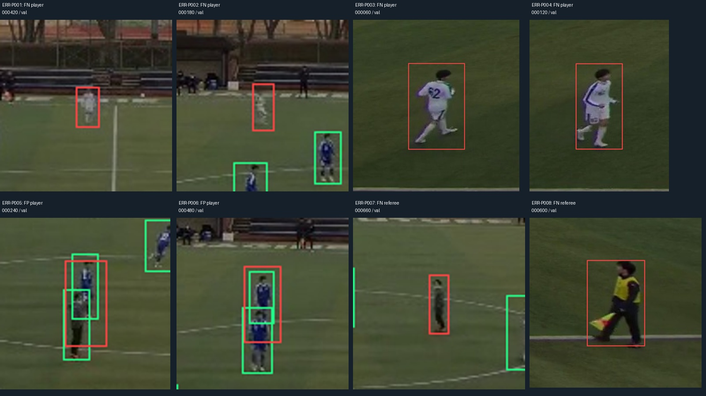

# Uitgevoerde spelertraining, evaluatie en overdracht

**16 oktober 2026.** Er is werkelijk een tweeklassendetector getraind en in het standaardmodelprofiel geregistreerd. Het gekozen bestand is `artifacts/players-v2/players_best.pt`: klasse **0 = player**, klasse **1 = referee**. De training en metingen draaiden op een **RTX 3050 Laptop GPU met 4 GB**, Python 3.12.14, PyTorch 2.6.0+cu124 en Ultralytics 8.3.221. Dit zijn geen gemeten prestaties van de beoogde RTX 4050.

De overdracht is voorlopig. Alle 60 beelden zijn door AI gecontroleerd; er zijn geen menselijke reviewers ingevuld. De verre officialrollen blijven onzeker. Een onafhankelijke projecteindtest en een menselijke geïntegreerde MVP-acceptatie zijn nog niet afgerond.

## 1. Data en bronwijziging

De [datasetbeschrijving](../datasets/teamtrack-players-v2/README.md) legt selectie, rollen, correcties en bronnen vast. Er zijn **60 beelden**, met **1320 spelerboxen en 120 boxen van de twee betrouwbaar geïdentificeerde officials**. De 36/12/12-verdeling gebruikt drie volledige tijdgroepen uit dezelfde wedstrijd, geen willekeurige losse frames. De bron-MOT-boxen komen van TeamTrack; roltoewijzing en aanvullende officialboxen zijn door AI uitgevoerd.

De bronnen verschillen van de oorspronkelijke YouTube/PANORIS-video: **6500 × 1000 pixels**, 25 fps, drie clips van 30 seconden. De beelden zijn niet verkleind of uitgesneden. Coördinaten blijven bronpixels. Bronbestandsnamen en SHA-256 staan in het manifest en [splitonderzoek](../reports/players-experiments/split-audit.json). De tijd tussen de laatst gekozen trainings- en eerste validatieframe is 92 seconden; tussen validatie en gereserveerde test 33,6 seconden.

De gelijkeniscontrole vindt 273 train/val-, 33 train/test- en 85 val/test-paren met gelijkende globale beeldhashes. De vaste panorama-achtergrond domineert die hashes; de hele beelden en veranderende acties zijn bekeken. Er zijn geen exact gelijke gedecodeerde beelden gevonden. Dezelfde wedstrijd, camera en kleding blijven een sterke beperking: tijdgroepen uit deze opname zijn geen onafhankelijke wedstrijden.

Bij het opnieuw ophalen van `main` kwam ook `assets/annotations/teamtrack0750` binnen: drie ontwikkelbeelden van dezelfde 0720–0750-groep, op frames 225, 250 en 275. Die liggen vlak bij gereserveerde testmomenten. De testgroep is daarom **geen onaangeroerde projecteindtest**. Er is geen eindtestscore gemaakt en er zijn geen testfouten gebruikt om EXP-P003 of EXP-P004 te selecteren.

## 2. Annotatiecontrole en afgewezen werk

Alle 60 bronbeelden en 22 speleruitsneden per beeld zijn bekeken. Rode en gele doelman zijn `player`. Gecontroleerde technische eigenschappen: leesbare beelden, bijbehorende labels, geldige klasse-ID's, positieve boxafmetingen en boxen binnen de bronafmetingen. De tweede persoon is niet nagebootst: `reviewer` blijft leeg en de reviewstatus is `ai_visual_checked`.

De eerste labelversie miste de centrale official. EXP-P001 op die versie is daarom als inhoudelijk ongeschikt bewaard. EXP-P002 is onderbroken nadat twee verkeerd geplaatste centrale-officialboxen op validatieframes 120 en 600 in de laatste visuele controle werden gevonden. De gecorrigeerde dataset heet **teamtrack-players-v2.1**; de map blijft `teamtrack-players-v2`.

Een wit spelersvoorstel op validatieframe 420 is verplaatst naar de nabije assistent met vlag. Proeven om verre zijlijnpersonen automatisch een officialrol te geven zijn verworpen. Die beelden zijn te ambigu om rollen consequent te bevestigen. De bewaarde [afgewezen voorstellen](../reports/players-experiments/rejected-role-proposals/README.md) zijn onderzoeksmateriaal en geen ground truth.

Dit betekent dat de klasse `referee` **onvolledig is geannoteerd**. Verre echte officials kunnen tijdens training achtergrond zijn of bij evaluatie als FP tellen. De officialscore is daarom een voorlopige diagnose op bekende officials, geen volledige meting van alle scheidsrechters. De spelerlabels dekken de 22 oorspronkelijke spelertracks, inclusief beide doelmannen.

## 3. Preprocessing en training

De [werkelijk uitgevoerde transformatiediagnose](../reports/players-experiments/preprocessing-audit.json) telt de behouden trainingsboxen in de vastgezette softwareversie:

| Ingestelde resolutie | Spelers vóór/na | Officials vóór/na | Werkelijke rechthoekige CHW-vorm |
| --- | ---: | ---: | --- |
| 640 | 792 / 439 | 72 / 37 | 3 × 128 × 672 |
| 960 | 792 / 755 | 72 / 52 | 3 × 192 × 992 |
| 1920 | 792 / 792 | 72 / 72 | 3 × 320 × 1952 |

Op de bronbeelden zijn personen ver weg erg klein. De keuze voor 1920 met rechthoekige batches voorkomt hier dat de trainingsfilter veel kleine boxen verwijdert. Dit is geen claim dat hogere resolutie ieder klein object betrouwbaar detecteert.

EXP-P003 gebruikt `yolo11n.pt`, resolutie 1920, batch 4, maximaal 100 epochs, patience 20, Adam, lr0 0,001, lrf 0,01, geen cosine schedule, warmup 3, bias-warmup 0, weight decay 0,0005, AMP, seed 42, deterministisch en `freeze=10`. Alleen horizontaal spiegelen heeft kans 0,5; de overige opgegeven augmentaties staan uit. De werkelijke defaults staan in `args.yaml`. `nbs=64` geeft na warmup nominale gradientaccumulatie van 16 minibatches bij batch 4; dit is geen fysieke batch van 64 beelden tegelijk. Er was geen OOM-retry nodig.

EXP-P003 stopte na **73 epochs**, met het frameworkcheckpoint van **epoch 53**. EXP-P004 verandert uitsluitend **freeze 10 → 0** en start opnieuw van pretrained gewichten. De hypothese en beslisregel zijn [vóór de run vastgelegd](../reports/players-experiments/EXP-P004-preregistration.json). EXP-P004 stopte na **78 epochs**, met het frameworkcheckpoint van **epoch 58**. Beide runs duurden ongeveer 0,059 GPU-trainingsuren volgens de logs; dit is geen totale installatietijd of 4050-benchmark.

De frameworkfitness selecteert het checkpoint binnen iedere run. De keuze tussen de runs gebruikt primair speler-AP@50:95, daarna speler-AP@50 op dezelfde validatieset. Volledige configuraties, provenance, broncodechecksums, logs, CSV-curves en checkpointidentiteiten staan onder [training](../reports/players-experiments/training/). Een sandboxfout verhinderde in sommige automatische records het uitlezen van de Git-dirtystatus; de afzonderlijke broncodehashes en trainingsbestanden zijn wel bewaard. De runs gebeurden met lokaal gewijzigde code op integratiebasis `69e0f9f`, niet met een fictief schoon releasecommit.

## 4. Echte validatieresultaten

Beide checkpoints zijn met dezelfde eigen evaluator gemeten: 101-punts geïnterpoleerde box-AP bij IoU 0,50:0,05:0,95, zonder crowd/ignore-ondersteuning. Dit is niet de volledige COCO-benchmark. De voorspellingen gebruiken resolutie 1920, confidence 0,001, NMS-IoU 0,70 en maximaal 300 detecties per beeld. Precision, recall, TP, FP en FN hieronder gebruiken afzonderlijk confidence **0,25** en matching-IoU **0,50**.

| Run | Klasse | Objecten op 12 beelden | AP@50 | AP@50:95 | Precision | Recall | TP / FP / FN |
| --- | --- | ---: | ---: | ---: | ---: | ---: | --- |
| EXP-P003, freeze 10 | player | 264 | 68,62% | 24,90% | 68,46% | 72,35% | 191 / 88 / 73 |
| EXP-P004, freeze 0 | player | 264 | **74,50%** | **26,55%** | 75,38% | 75,38% | 199 / 65 / 65 |
| EXP-P003, freeze 10 | referee, beperkte dekking | 24 | 50,50% | 36,38% | 92,31% | 50,00% | 12 / 1 / 12 |
| EXP-P004, freeze 0 | referee, beperkte dekking | 24 | 49,81% | 36,28% | 100,00% | 41,67% | 10 / 0 / 14 |

Gemiddeld over beide opgegeven klassen: EXP-P003 mAP@50 **59,56%**, mAP@50:95 **30,64%**; EXP-P004 **62,16%** en **31,41%**. De onvolledige officialdekking beperkt ook de betekenis van deze klassegemiddelden. De ruwe metingen en [CSV-resultaten](../reports/players-experiments/validation-results.csv) zijn de bron voor de tabel.

**Gekozen: EXP-P004.** Speler-AP@50:95 stijgt 1,65 procentpunt, AP@50 5,88 procentpunt. Er zijn 23 minder speler-FP en 8 minder speler-FN op het werkpunt. De official-recall wordt juist slechter. Dit is een afweging ten gunste van spelertracking, geen verbetering van iedere taak en geen statistisch bewezen winst op andere wedstrijden.

## 5. Betekenis van de pretrained vergelijking

Het pretrained COCO-model kent `person`, geen speler- of scheidsrechterrol. Daarom krijgt het geen verzonnen `player`- of `referee`-baseline-AP. Voor een aanvullende **lokalisatieproxy** worden de geannoteerde deelnemers samengenomen en worden ook de twee fine-tuningklassen samengenomen, met exact dezelfde inferentie-instellingen en evaluator.

| Uitvoer, zonder rollen te beoordelen | AP@50 | AP@50:95 |
| --- | ---: | ---: |
| Pretrained `person` | 60,17% | 20,36% |
| EXP-P003, rollen samengenomen | 69,82% | 27,39% |
| EXP-P004, rollen samengenomen | 74,91% | 27,96% |

Deze proxy meet geen rolherkenning. Ongeannoteerde zijlijnpersonen en verre officials beperken hem bovendien. Het bronklassenaamveld blijft `person`; de pipeline hernoemt dat niet stilzwijgend naar `player`. Reproductie: `python -m persoon1.participant_baseline` met de vastgelegde manifest-, attestation-, gewichten- en predictionpaden.

## 6. Fouten en toetsbare verklaringen



Groen zijn referentieboxen; rood is het betrokken gemiste object of de foutieve voorspelling. De [records](../reports/players-experiments/reviewed-error-examples.json) bevatten exacte frame-ID's en bronuitsneden. FP/FN zijn gebeurtenissen; één beeld kan meerdere gebeurtenissen bevatten.

| Voorbeelden | Wat zichtbaar is | Hypothese en alternatief | Passende volgende controle |
| --- | --- | --- | --- |
| ERR-P001–002 | Kleine, wazige witte spelers op afstand worden gemist bij het werkpunt. | Weinig invoerdetail; alternatief: confidence te laag of box-IoU onvoldoende. | Vergelijk bronpixelgrootte, modelinvoergrootte en nabijgelegen voorspellingen vóór een groter-resolutie- of tilingexperiment. |
| ERR-P003–004 | Ook grote witte spelers kunnen een FN krijgen. | Detailverlies alleen verklaart dit niet; mogelijke confidence-, klasse- of lokalisatiefout. | Inspecteer de volledige predictionlijst en IoU, niet alleen de getekende box. |
| ERR-P005 | Een voorspelde spelerbox beslaat een blauwe speler en een overlappende centrale official. | Samengevoegde lokalisatie en rolverwarring; alternatief: afzonderlijke voorstellen zijn door NMS verwijderd. | Inspecteer voorstellen vóór NMS en vergelijk overlapgevallen. |
| ERR-P006 | Twee overlappende blauwe spelers leveren een onvoldoende passende samengestelde voorspelling. | Onvoldoende scheiding; alternatief: NMS-onderdrukking. | Vergelijk per-object-IoU en pre-NMS-voorspellingen. |
| ERR-P007 | De centrale official blijft gemist. | Klein grijs doel en weinig gevarieerde voorbeelden; alternatief: klassentoewijzing of confidence. | Meer betrouwbare officiële rolvoorbeelden en een gerichte detailcontrole; geen algemene scheidsrechterclaim. |
| ERR-P008 | Zelfs de nabije assistent wordt soms gemist op confidence 0,25. | Tijdelijke blur of confidencevariatie; alternatief: boxlokalisatie. | Bekijk de confidence en aangrenzende ontwikkelframes bij de ingestelde pipelinegrens 0,10. |

De hypothese “alle fouten komen door kleine objecten” is verworpen als volledige verklaring: er zijn ook grote gemiste spelers en samengevoegde boxen. Alleen training-AP noemen zou deze fouten verbergen. Evaluatielabels zijn niet aangepast om de score te verhogen.

## 7. Wat persoon 2 werkelijk krijgt

- [Geselecteerde gewichten](../artifacts/players-v2/players_best.pt), ook via Git LFS; referentiecheckpoints EXP-P003 en EXP-P004 zijn bewaard.
- SHA-256 **e81c648679da69579f5b07e420f9853f7f965b005b5f21cb792bd900ab96f498**; werkelijke modelnamen zijn uit het gewichtenbestand gelezen en gecontroleerd.
- [Standaardprofiel](../configs/models.json) en [expliciet spelerprofiel](../configs/models-players.json): resolutie 1920, confidence **0,10**, NMS-IoU 0,70, GPU-device 0. Er is geen balmodel toegevoegd dat onbetrouwbare validatiewinst claimt.
- [Overdrachtrecord](../reports/players-experiments/handoff.json), met evaluatiepad/hash, data-identiteit, software en beperkingen.
- [Werkelijke detectoruitvoer](../reports/handoff/players-v2/detections.jsonl) op 12 validatiebeelden, met 388 detecties bij confidence 0,10. Boxen zijn gecontroleerd in oorspronkelijke 6500 × 1000-pixels.
- Normaal, moeilijk en leeg framerecord. Het lege record komt uit echte inference met diagnostische confidence **1,0** en dient uitsluitend om de lege lijst te controleren; dit is geen normale gebruiksinstelling of prestatiemeting.

De geselecteerde klasse-ID's sluiten nu rechtstreeks op de spelertracker aan. Dat bewijst geen foutloze rolherkenning: officials kunnen nog onterecht als speler worden gedetecteerd. ByteTrack blijft achter de bestaande MVP-acceptatie staan. Er is geen menselijke acceptatie of trackingreferentie verzonnen.

In de vastgezette GPU-versie 8.3.221 nummert ByteTrack de confidencegroepen opnieuw. Daardoor kreeg in een bestaande compatibiliteitstest de verkeerde detectie een ID. De adapter bewaart voor deze versie nu de oorspronkelijke indices door beide associatiestappen. De test controleert hoge en lage scores, lege frames, herintrede en uitsluiting van `referee`. Andere versies behouden hun bestaande native route.

## 8. Starten en reproduceren op de 4050

Werk op `main` en haal de grote bestanden werkelijk op:

```powershell
git pull --no-rebase origin main
git lfs pull
.\scripts\Setup-Persoon1.ps1
.\scripts\Start-Spelermodel.ps1
```

Gebruik Python 3.12 en een eigen lokale `.venv`. De GPU-setup behoudt CUDA-PyTorch en installeert ook de toepassing. Installeer de aparte CPU-`requirements.lock` niet over deze GPU-omgeving. De bewaarde `requirements-players-gpu.lock` is de werkelijke pakketsnapshot. De automatische veldkalibratie heeft daarnaast de geïsoleerde runtime uit [de kalibratiehandleiding](Automatische_Veldkalibratie.md) nodig.

Nameten van het geleverde checkpoint:

```powershell
.\scripts\Start-Spelermodel.ps1 -Mode evaluate
```

Opnieuw trainen van de geselecteerde configuratie:

```powershell
.\scripts\Start-Spelermodel.ps1 -Mode train
```

De referentierun met freeze 10 is beschikbaar via `-TrainingConfig configs/train-players-reference.json`. Iedere uitvoering krijgt een nieuwe runmap. `-Mode annotate` toont alle 60 bewaarde beelden; `-Mode validate` controleert de huidige dataset. `-Device cpu` is een expliciete alternatieve uitvoering en geen GPU-benchmark.

## 9. Grenzen van de oplevering

Na het samenvoegen met de nieuwste veldkalibratie zijn **146 softwaretests en 4 subtests geslaagd**, zonder failures, errors of skips. De broncontrole en pakketcontrole slagen ook. Het [testrecord](../reports/players-experiments/software-validation.json) verwijst met hash naar de volledige testuitslag. Dit zijn softwarecontroles; de echte validatie-mAP staat afzonderlijk hierboven.

Werkelijke fine-tuning, validatie, modelselectie, bronregistratie en detectorintegratie zijn uitgevoerd. Open blijven: onafhankelijke menselijke annotatiebetrouwbaarheid, volledige verre officialdekking, een onaangeroerde eindtest op een nieuwe groep, brongebonden kalibratiecontrole, echte geïntegreerde MVP-review en later gecontroleerde trackingidentiteiten. De oorspronkelijke balexperimenten zijn apart bewaard in [het balverslag](Resultaten_Balexperimenten.md); hun negatieve validatie-uitkomst wordt niet verborgen.
